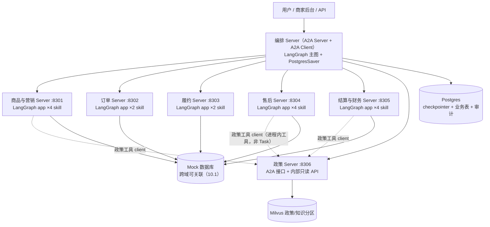
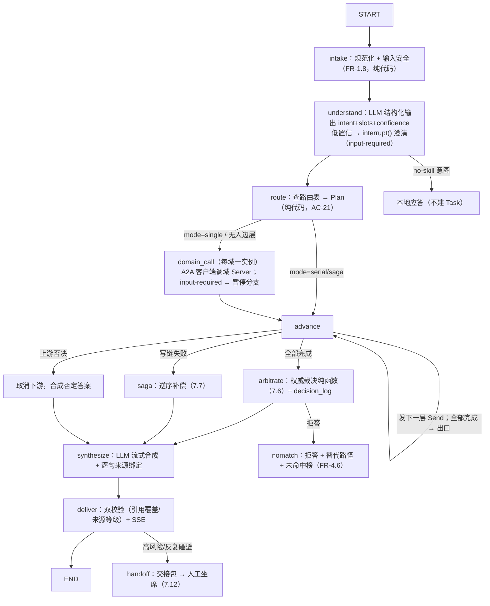

# AgentDock · LangGraph 技术方案

| 项目 | 内容 |
|---|---|
| 配套文档 | 《PRD-AgentDock.md》v2.2（2026-10-24） |
| 文档定位 | 把 PRD 第 3 章（域地图）与第 7 章（A2A 协作）落成可运行工程的技术方案 |
| 架构形态 | **一主（编排 Server，LangGraph StateGraph）+ 六子（域 A2A Server，各自 LangGraph app + a2a-sdk）** |
| 文档版本 | v1.0 |
| 编制日期 | 2026-10-24 |
| 目标读者 | 研发、架构评审 |

> 阅读前提：PRD v2.2 已确定——订单、履约为两个独立域 Agent（一域一 Agent，共 5 业务域 + 1 政策横切 + 1 编排 = 7 部署单元）；政策横切为“子 Agent + 内部只读 API”双形态；从 M1 起每域就是独立 A2A Server。本文只回答“怎么实现”，不重复回答“为什么这么拆”。

---

## 1. 技术选型与总体拓扑

### 1.1 选型

| 层 | 选型 | 对应 PRD | 说明 |
|---|---|---|---|
| 图编排 | **LangGraph**（Python，`StateGraph`） | 7.5 路由执行、7.3.2 Task 生命周期 | 一主六子全部是 LangGraph app；主图管编排，域图管域内多步推理 |
| 协议层 | **a2a-sdk**（Python，Starlette 应用） | 第 7 章全部 | AgentCard / Task / SSE / CancelTask / 验签；每个 Server = LangGraph app 外包一层 executor |
| 状态持久化 | **PostgresSaver**（checkpointer）+ Postgres 业务表 | 7.3.2 Task 状态、10.3/10.4 | Task 可恢复 = graph 可恢复，这是选 LangGraph 的最大红利 |
| 向量库 | Milvus（按租户 + 域分区） | FR-4.2、10.3 | 只有政策与知识类工具用；纯结构化工具直查 Postgres |
| 可观测 | LangSmith + OTel（`trace_id` 进 run metadata） | 7.10 | 每跳透传，跨进程拼出完整调用树 |
| LLM | 意图分类用小模型；域内推理与合成用主模型 | 9.3 降本 | 结构化输出（intent+slots、Artifact） |

### 1.2 拓扑



- 实线 = A2A 委托（建 Task，走 7.3 全套生命周期）。
- 虚线 = 政策工具 client（进程内工具调用政策 Server 的内部只读 API，**不建 Task**，PRD 7.3.7 政策例外）。权威文本与版本仍归政策 Server。

### 1.3 “一主多子”的边界

| | 主（编排） | 子（6 个域 Server） |
|---|---|---|
| LangGraph 形态 | 一张 StateGraph | 每域一张（多数是 ReAct 小循环） |
| 持有业务数据 | **无**（7.1 硬约束） | 本域权威表 + 本域知识分区 |
| LLM 职责 | 意图/槽位抽取、澄清话术、答案合成 | 域内多步推理（判定资格、解读参数、合成条款引用） |
| 代码职责 | **路由、扇出、取消、裁决、Saga、快照**（全部纯代码/纯函数，7.5） | 工具调用、权限校验、Artifact 组装 |

### 1.4 与“经典 supervisor 模式”的差别（必读）

LangGraph 教程里的 supervisor 是：**LLM 每一步决定下一个调谁**。本方案**不允许**（PRD 7.5：同一句话两次请求必须走同一条域链，AC-21 要求 100% 确定）。

| | 经典 supervisor | AgentDock 编排 |
|---|---|---|
| 谁决定下一步 | LLM | 路由表（配置文件）+ 拓扑调度器（代码） |
| LLM 出现在 | 每一步 | 只在 `understand`（intent+slots）与 `synthesize`（合成）两个节点 |
| 可测试性 | 只能端到端测 | 路由表可单测、裁决器是纯函数、域图有独立评测集（8.6） |
| 权限 | 靠 prompt 约束 | 每次委托都是一次新的 L1/L2/L3 校验（8.2） |

所以主图里的“supervisor 节点”其实是三件事：`understand`（LLM）→ `route`（查表）→ `advance`（拓扑调度器，代码）。

---

## 2. 一主：编排 Server

### 2.1 共享 State

```python
from typing import Annotated, Literal, TypedDict
from langgraph.graph.message import add_messages

def merge_dict(left: dict, right: dict) -> dict:
    return {**left, **right}

class Plan(TypedDict):
    intent: str
    domains: list[str]                     # ["aftersale", "fulfillment", "finance"]
    edges: list[tuple[str, str]]           # [("aftersale", "fulfillment"), ...]
    mode: Literal["single", "parallel", "serial", "arbitrate", "saga"]

class OrchestratorState(TypedDict):
    messages: Annotated[list, add_messages]
    intent: str
    slots: dict                            # 语义/事实槽位；系统槽位从 token 注入，不进这里
    confidence: float
    plan: Plan | None                      # route 节点产出
    snapshot_id: str
    artifacts: Annotated[dict[str, dict], merge_dict]   # domain -> Artifact data（权威带 as_of/snapshot_id）
    decision_log: Annotated[list[dict], merge_dict]     # 7.6 裁决记录（含被丢弃候选值）
    cancelled_domains: Annotated[list[str], merge_dict] # 上游否决 → 下游不发（= CancelTask 语义）
    paused_questions: Annotated[list[dict], merge_dict] # 各域 input-required 的合并追问（只问一次）
    clarify_count: int                     # 同一 contextId 最多澄清 1 次（6.1.1）
    completed_writes: list[dict]           # Saga 正向步（domain, skill, biz_key）
    source_bindings: list[dict]            # 合成阶段的逐句来源绑定
    prompt_version: str
```

要点：

- `artifacts` 用 dict 合并 reducer——每个 `domain_call` 分支只写自己的 key，天然并行安全。
- `cancelled_domains` / `paused_questions` 同理：多分支各自追加，主流程消费。
- 系统槽位（`tenant_id` / `customer_id` / `scope`）**不进 State 的自然语言部分**，由 A2A 层从 token claim 取出后放进 run config metadata（6.1.1 表 2：禁止从自然语言获取）。

### 2.2 主图结构



节点职责：

| 节点 | 类型 | 职责 | 对应 PRD |
|---|---|---|---|
| `intake` | 代码 | 纠错/全半角/口语补全、注入特征与越权意图拦截、长度与敏感词 | FR-1.8 |
| `understand` | LLM | 输出 `{intent, slots, confidence, top2}`；财务类意图阈值上浮；低于阈值 `interrupt()` 澄清（带 top-2 可点选项） | 6.1.1(1)(4)(5) |
| `route` | 代码 | `(intent, 槽位齐全性) → Plan`；生成 `snapshot_id`；查同任务去重缓存 | 7.5、7.3.7 |
| `advance` | 代码 | **拓扑调度器**：每轮把“无未满足入边”的域用 `Send` 发出；收集完一层再发下一层；全部完成/取消/失败时决定出口 | 7.5 执行规则 1–3 |
| `domain_call` | 代码 | A2A 客户端调用域 Server（`SendMessage` 或 `SendStreamingMessage`）；处理超时（`CancelTask`）、重试（7.3.6 一级）、`input-required`/`auth-required` 的分支暂停 | 7.3 |
| `arbitrate` | **纯函数** | 按 `fact_type` 查 3.4 矩阵选权威值，丢弃值写 `decision_log`；快照偏差 > 5min 触发一次重拉 | 7.6、7.8 |
| `saga` | 代码 | 按 `completed_writes` 逆序调补偿 skill；幂等键 `biz_key = contextId + action + target_id`；补偿失败升级人工 | 7.7 |
| `synthesize` | LLM | 流式合成，逐句带 `source_level` + `authority_domain`；合成句必须可分解（7.11 硬规则 7） | FR-1.10 |
| `deliver` | 代码 | 引用覆盖率与来源等级双校验（不达标转拒答）；SSE 下发答案卡片；写审计 | FR-1.5、8.3 |
| `nomatch` / `handoff` / `smalltalk` | 代码 | 拒答替代路径 / 交接包 / 本地意图（`no-skill` 不建 Task） | FR-1.6、7.12、6.1.1 |

### 2.3 并行与串行：分层调度（对齐 7.5 执行规则）

PRD 的依赖图执行规则在 LangGraph 里的落地方式是**“advance 循环 + Send 分层扇出”**：

```python
# advance 节点的核心逻辑（示意）
def advance(state) -> Command | dict:
    plan, done, cancelled = state["plan"], state["artifacts"], state["cancelled_domains"]

    # 1) 上游否决/失败 → 下游不发（= CancelTask，AC-23）
    newly_cancelled = propagate_cancellation(plan, done, cancelled)

    # 2) 下一层可运行的域（入边全部 completed 且不在 cancelled）
    ready = topo_ready(plan, done, newly_cancelled)
    if ready:
        calls = [Send("domain_call", build_delegation(d, state)) for d in ready]
        return Command(goto=calls)                    # 无入边并发 = 7.5 规则 1

    # 3) 全部层完成 → 出口
    if any_write_chain_failed(state):
        return Command(goto="saga")                   # 7.7：写链失败进补偿
    return Command(goto="arbitrate" if plan["mode"] == "arbitrate" else "synthesize")
```

- **并行**（如订单查询 = 订单 ∥ 履约）：一层内多个 `Send`，LangGraph 原生并发执行，各自更新 `artifacts[domain]`。
- **串行**（如退款到账 售后→履约→财务）：`advance` 每层只发无入边的域，收齐一层再发下一层——依赖顺序由**数据**（`artifacts` 是否含上游 key）驱动，不靠 LLM。
- **并行头 + 串行尾**（改价开票 = 商品 ∥ (履约→订单→财务)）：同一套调度器天然支持，商品在第 0 层，履约在第 1 层。串行深度 ≤ 3、并行域数 ≤ 4 由 `route` 在生成 Plan 时静态校验（R15）。
- **分阶段交付**（FR-1.11）：`advance` 每收齐一层就向前端推一条“阶段性结论”SSE 事件（如“符合退货条件”），不必等整链完成。
- **去重**：`Send` 发出前查 TTL 缓存（`contextId + skill + slots_hash`），命中则直接写入 `artifacts`，不发 Task（7.3.7，省 8–12% 调用）。

### 2.4 A2A ↔ LangGraph 状态映射（本文核心）

| A2A 概念 | LangGraph 对应 | 实现要点 |
|---|---|---|
| `SendMessage` 建 Task | `graph.astream(Command(resume=…)? , cfg)`，`thread_id = task_id` | 每个新 Task 一个新 thread；`contextId` 存 thread metadata |
| `working` | `astream_events` 中的节点/模型事件 | 映射为 SSE `TaskStatusUpdateEvent(working)` |
| **`input-required`** | **`interrupt(payload)`** | `understand` 澄清与域分支暂停共用；payload = top-2 候选 / 域的追问，进 `status.message` 的 DataPart（可点选） |
| 同 taskId 回填 | `Command(resume=user_reply)` 恢复同一 thread | checkpointer 还原全部状态，从断点继续——**免费获得“多轮澄清天然带状态、可恢复、可审计”（7.3.2）** |
| `auth-required` | `interrupt({"type": "auth", scope: ...})` | 用户二次授权后 resume；未授权 → 置 `rejected` |
| `completed` | graph 终态 | 终态 `artifacts` → A2A Artifact（data part 带 `authority` / `as_of` / `snapshot_id`） |
| `failed` | 域调用抛业务异常 | executor 捕获 → Task `failed`；重试/降级策略在 `domain_call`（7.3.6 一、二级），三级局部交付在 `synthesize` |
| `rejected` | 域 Server 权限中间件直接短路 | 不进域图；编排层不重试、写审计 |
| `canceled` | `cancelled_domains` + `CancelTask` 客户端调用 | 调度器“不发”即取消（未发出的分支）；已发出的靠客户端 `CancelTask`（超时预算 800ms） |
| `contextId` 多轮 | thread metadata + 会话摘要表 | 近 N=6 轮原文 + 滚动摘要（10.4），由编排层注入 understand/synthesize |
| `ListTasks` 复盘 | checkpointer `get_thread_history` + task 视图表 | 按 `contextId` 过滤出一次会话的全部 Task（FR-2.8） |
| `metadata` 透传 | run config `metadata` / `tags` | `trace_id` / `tenant_id` / `snapshot_id` / `delegation_depth` / `ancestor_agents` 逐跳透传，域 Server 起新 span（7.10） |

**TaskStore 选型**：a2a-sdk 默认 `InMemoryTaskStore` 不满足“Task 可恢复”，替换为基于 Postgres 的 TaskStore——`taskId → (thread_id, status)`，重启后仍能回填澄清、复盘链路（AC-14）。

### 2.5 裁决器（arbitrate）

```python
AUTHORITY_MATRIX = {   # 3.4 的代码化，唯一裁决依据
    "成交价": "order", "到手价": "finance", "ATP": "fulfillment", "订单状态": "order",
    "退换修资格": "aftersale", "退款金额": "finance", "到账时间": "finance",
    "发票状态": "finance", "政策条款": "policy", ...
}

def arbitrate(fact_type: str, candidates: list[dict]) -> Decision:
    authority = AUTHORITY_MATRIX[fact_type]
    winner = next(c for c in candidates if c["domain"] == authority)
    # 快照偏差检查：max(as_of)-min(as_of) > 5min → 重拉一次，仍超则标注
    return Decision(value=winner, authority=authority, dropped=[c for c in candidates if c is not winner])
```

- 纯函数：`(fact_type, candidates) → (value, authority, reason)`，可单测、可回放（AC-22）。
- **禁止 LLM 参与**；LLM 只负责把裁决结果说人话（synthesize）。
- 每次裁决写 `decision_log`（含被丢弃候选值）进审计（8.3）。

---

## 3. 六子：域 Server 模板

六个域 Server **同构**，差异只有四个文件：`prompt.py`、`tools.py`、`card.py`、`schemas.py`。

### 3.1 标准结构

```python
# domains/aftersale/server.py（示意；接口名以 a2a-sdk 实际版本为准）
from a2a.server.apps import A2AStarletteApplication
from a2a.server.request_handlers import DefaultRequestHandler
from a2a.types import AgentCard, AgentCapabilities, AgentSkill

card = AgentCard(
    name="售后 Agent",
    url="http://aftersale:8304/",
    version="1.0.0",
    skills=[
        AgentSkill(id="aftersale.eligibility", name="售后资格判定", tags=["aftersale"]),
        AgentSkill(id="aftersale.reason",      name="责任判定",       tags=["aftersale"]),
        AgentSkill(id="ticket.create",         name="建维修工单",     tags=["aftersale"]),
        AgentSkill(id="ticket.query",          name="工单进度查询",   tags=["aftersale"]),
    ],
    capabilities=AgentCapabilities(streaming=True),
    security_schemes=OAUTH_CLIENT_CREDENTIALS,      # 7.3.5：scope 精确到 skill
    # x-domain="aftersale" 作为 Card 扩展字段随签名一起发布（7.3.1）
)

graph = build_domain_graph(
    system_prompt=AFTERSALE_PROMPT,                 # prompt_version 入 state，灰度/回滚（7.4）
    tools=[judge_eligibility, determine_responsibility, create_ticket, query_ticket],
    artifact_schema=AftersaleArtifact,              # shared/schemas：authority/as_of/snapshot_id 必填
)

handler = DefaultRequestHandler(
    agent_executor=LangGraphTaskExecutor(graph, domain="aftersale"),
    task_store=PostgresTaskStore(...),
)
app = A2AStarletteApplication(agent_card=card, http_handler=handler).build()
```

`LangGraphTaskExecutor`（六个域共用，放 `shared/`）做四件事：

1. 把 A2A `Message`（text + data parts）转成域图输入；`metadata` 进 run config。
2. 跑 `astream_events`：token 流映射 SSE（working），域内工具调用起 span。
3. 停在 `interrupt()` → Task 置 `input-required` / `auth-required`（payload 进 status message）。
4. 终态 → 一个 A2A Artifact：`parts=[DataPart(artifact_schema), TextPart(人话摘要)]`，`metadata` 带 `authority_domain` / `as_of` / `snapshot_id`。

### 3.2 域内 ReAct 循环与工具

每个域图就是一个紧凑循环：`llm（可调工具）→ tools → llm → … → emit_artifact`。约束：

- **工具 = skill**：一个 `@tool` 函数对应 Card 里的一个 skill id（映射见第 6 章），工具描述写清“何时该用/何时不该用”。
- **权限前置**：所有工具经一个装饰器包一层——先查 scope（L2），再注入行级过滤（L3），再脱敏；未过直接返回结构化 `rejected`，不进 LLM 上下文（8.2）。
- **政策工具**：售后/财务等域的 `judge_eligibility` / 开票资质校验内部持有 `PolicyClient`（见 3.4），条款引用必须带 `clause_id + version + effective_range` 写进 Artifact（AC-31）。
- **禁止横向委托**：域图里没有“调用其他域 Agent”的工具——这是 7.3.7 的架构级保证：想跨域，只能 `input-required`/返回结论，由编排层重新路由。

### 3.3 Agent Card 约定

| 字段 | 取值 | 备注 |
|---|---|---|
| `skills[]` | 本域 2–4 个 skill | skill 是路由最小单位，与意图多对多 |
| `capabilities.streaming` | 合成/检索类 true；`compare.matrix` false（产物一次性） | 7.3.1 |
| `x-domain` | `merchandising / order / fulfillment / aftersale / finance / policy` | 与 10.5 数据层枚举一一对应（v2.2） |
| 签名 | JWS（RFC 8785 规范化） | 编排层发现时验签，TTL 5 分钟缓存（9.2 约束 4） |
| 密钥 | `infra/keys/`（dev 用本地密钥，prod 上 KMS） | 每个 Server 发布时私钥签名 |

### 3.4 政策 Agent 双形态实现

```python
# domains/policy/internal_api.py —— 与 A2A Server 同进程，挂 /internal/* 前缀
@router.get("/internal/clauses")
async def get_clauses(q: str, model: str | None = None,
                      tenant: Tenant = Depends(verify_internal_token)):
    # 复用政策 Server 的检索内核：Milvus 政策分区 + 生效期硬过滤（8.4）
    return {"clauses": policy_retriever.search(q, model),
            "each": {"clause_id", "version", "effective_from", "effective_to", "text"}}

# shared/policy_client/client.py —— 各域 Server 内嵌
class PolicyClient:
    """进程内工具的后端。只读；政策 Agent 停机时抛 PolicyUnavailable → 域降级为“条款暂不可查”。"""
    @tool
    def lookup_clause(self, query: str, model: str | None = None) -> ClauseRef: ...
```

- 内部 API 鉴权用**服务间内部 token**（≠用户身份；用户权限由调用域自己校验）。
- 为什么不直接读库：权威文本、版本、生效期判定逻辑只实现一份，各域永远拿到“生效版条款”（PRD 3.2：不得各自存副本；R11：过期比编造更难发现）。
- 意图 13（政策咨询）与跨域并行委托（如 D-5 保修判定）仍走 A2A Task——两种形态共存，一条权威数据。

---

## 4. 权限与脱敏落点

| 层 | 位置 | 实现 |
|---|---|---|
| L1 租户 × 域 | 编排 Server，`route` 之后 | `tenant × domain` 授权表；未授权域直接从 Plan 里剔除并标注（8.2） |
| L2 域 × skill | 域 Server A2A 中间件 + 工具装饰器 | token scope 精确到 skill（如 `refund.status`）；`rejected` 不重试 |
| L3 行级 | 域内工具层 | `customer_id` 从 token claim 注入查询（**用户报的单号只作过滤条件，与登录态单据列表取交集**，6.1.1 表 2） |
| on-behalf-of | 域 Server 入口 | 同时校验“用户身份 + 调用方（编排）身份”，客服借 AI 之手看财务数据这条路被堵死（8.2 第 3 条） |
| 脱敏 | 数据访问层，**进 LLM 上下文之前** | 成本价、信用额度等字段按 scope 剔除；输出侧再加一层禁用词/绝对化用语校验（8.9） |

---

## 5. 跨域能力实现清单（对照 PRD 第 7 章）

| PRD 机制 | 实现位置 | 关键点 |
|---|---|---|
| 7.5 域路由 | `orchestrator/route_table.py`（YAML/Py） | 纯配置；AC-28 新域 = 加一行；`route` 附带深度/并行静态校验 |
| 7.6 权威裁决 | `orchestrator/arbitrate.py` | 纯函数 + `AUTHORITY_MATRIX` + decision_log |
| 7.7 Saga | `orchestrator/saga.py` | `completed_writes` 栈；补偿动作表（每个写 skill 注册 compensate）；逆序执行；失败进人工队列 + 告警 |
| 7.8 快照 | `route` 生成 `snapshot_id`；`arbitrate` 校验偏差 | >5min 重拉一次，仍超则标注“时点不一致” |
| 7.3.7 去重 | `advance` 发 Send 前 | TTL 缓存 `contextId+skill+slots_hash` |
| 7.3.7 防环/深度 | `route` + `domain_call` | `delegation_depth`、`ancestor_agents` 随 metadata 透传；超限 `rejected` + 告警 |
| 7.3.6 重试 | `domain_call` | 一级重试 1 次（指数退避 ≤300ms）→ 二级降级（备用 Agent/退化能力）→ 三级局部交付；不重试清单照 PRD |
| 7.10 Trace | `shared/tracing` | `trace_id`/`span_id` 进 a2a metadata 与 LangSmith run metadata，跨 7 个进程拼一棵调用树 |
| 7.4 Prompt 版本 | `shared/prompts` + state.`prompt_version` | 改模板视同改产品行为，过评测回归（8.6） |

---

## 6. Mock 数据与 18 个 skill 的工具映射

Mock 数据按 PRD 10.1 落在 `infra/mockdata/`（SQLite + JSON，**跨域可关联**：退款单 → 售后单 → 订单 → SKU）：

| # | 域 | skill | 工具函数（示意签名） | Mock 表 | 写 / 补偿 |
|---|---|---|---|---|---|
| 1 | 商品与营销 | `product.retrieve` | `search_products(filters) -> candidates` | products | 只读 |
| 2 | 商品与营销 | `product.lookup` | `get_product(sku) -> spec` | products | 只读 |
| 3 | 商品与营销 | `compare.matrix` | `compare_matrix(candidate_artifact_id)`（只消费 Artifact，不二次拉参） | products | 只读 |
| 4 | 商品与营销 | `promo.evaluate` | `evaluate_promo(sku, coupons) -> estimate` | promos, coupons | 只读（到手价标“估算”） |
| 5 | 订单 | `order.query` | `get_order(order_no, customer_id)` | orders | 只读 |
| 6 | 订单 | `order.amend` | `amend_price(order_no, new_price)` | orders | 写 / 撤销改价（幂等） |
| 7 | 履约 | `fulfill.atp` | `check_and_lock_atp(sku, qty, warehouse)` | inventory | 写 / 释放锁定（幂等） |
| 8 | 履约 | `fulfill.track` | `track_nodes(order_no)` | fulfillment_nodes | 只读 |
| 9 | 售后 | `aftersale.eligibility` | `judge_eligibility(sku, buy_date)`（内部调 PolicyClient） | aftersales | 只读 |
| 10 | 售后 | `aftersale.reason` | `determine_responsibility(fault_type)` | aftersales | 只读 |
| 11 | 售后 | `ticket.create` | `create_ticket(payload)` | tickets | 写 / 作废工单（幂等） |
| 12 | 售后 | `ticket.query` | `get_ticket(ticket_no)` | tickets | 只读 |
| 13 | 结算与财务 | `billing.statement` | `get_statement(period)` | bills | 只读 |
| 14 | 结算与财务 | `invoice.issue` | `issue_invoice(order_no, kind)` | invoices | 写 / 冲红（幂等） |
| 15 | 结算与财务 | `refund.status` | `get_refund(refund_no)` | refunds | 只读（到账时间缺失即拒答） |
| 16 | 结算与财务 | `refund.settle` | `settle_refund(refund_no)` | refunds | 写 / 退回原状态（幂等） |
| 17 | 政策 | `policy.answer` | `answer_policy(query)` | policy_docs（Milvus 政策分区） | 只读 |
| 18 | 政策 | `policy.clause` | `get_clause(clause_id)`（版本 + 生效期硬过滤） | policy_docs | 只读 |

---

## 7. 仓库结构（monorepo）

```
agentdock/
├── infra/
│   ├── docker-compose.yml        # 7 服务 + postgres + milvus + mock-db，一键起
│   ├── keys/                     # Card 签名密钥（dev）
│   └── mockdata/                 # PRD 10.1 四域 Mock 数据（跨域可关联）
├── shared/
│   ├── schemas/                  # Artifact Pydantic 模型（authority/as_of/snapshot_id 必填）
│   ├── auth/                     # scope→skill、on-behalf-of、行级注入、脱敏过滤器
│   ├── policy_client/            # 政策工具 client（各域内嵌，调政策内部只读 API）
│   ├── tracing/                  # a2a metadata ↔ OTel/LangSmith 透传
│   ├── prompts/                  # prompt 版本库（prompt_version 灰度）
│   └── a2a_langgraph.py          # LangGraphTaskExecutor + PostgresTaskStore（六域共用）
├── orchestrator/
│   ├── graph.py                  # 主图：intake→understand→route→advance→…→deliver
│   ├── route_table.py            # 7.5 路由表（纯配置）
│   ├── arbitrate.py              # 7.6 纯函数裁决
│   ├── saga.py                   # 7.7 补偿表与逆序执行
│   ├── state.py                  # OrchestratorState
│   └── server.py                 # a2a-sdk 包裹 + PostgresSaver
├── domains/
│   ├── merchandising/            # prompt.py / tools.py / card.py / schemas.py / server.py
│   ├── order/
│   ├── fulfillment/
│   ├── aftersale/
│   ├── finance/
│   └── policy/                   # 额外：internal_api.py（内部只读检索）
└── tests/
    ├── contract/                 # 工具级合同测试：18 个 skill × scope 矩阵 × 行级权限
    ├── routing/                  # 路由表确定性（AC-21：100 次一致）
    └── e2e/                      # 附录 D 六剧本（含异常注入）
```

---

## 8. 里程碑映射（对齐 PRD 第 12 章）

| 里程碑 | 本方案交付 |
|---|---|
| M1 | `shared/` 全量 + 编排 Server（intake/understand/route/单域 dispatch/deliver）+ 商品与营销 Server + compose 骨架（其余 5 域为桩 Server：Card 可发现、调用返回 `rejected`）+ PostgresSaver + Card 签发/验签 |
| M2 | 政策 Server（A2A + internal API）+ 售后 Server + `advance` 并行调度 + 双域并行链路 + 政策工具 client |
| M3 | 订单 / 履约 / 财务三个 Server + 串行调度与上游否决 + arbitrate + saga + 快照校验（AC-21~27、AC-31） |
| M4 | L1 授权表、审计哈希链、OTel 指标与域级健康看板、对账 job（8.8） |
| M5 | 供应链桩域接入演练（AC-28：只加 Card + 路由行 + 知识）、分阶段交付打磨、阈值标定 |

---

## 9. 测试与可观测

- **合同测试**：每个工具函数直接测（Mock 数据、scope 矩阵、行级越权用例）；域 Server 层面以 Card 为契约——skill 存在性、Artifact schema、状态合法跃迁。
- **路由测试**：AC-21 的 100 次确定性、AC-28 的新域接入，都是对 `route_table.py` 的纯单测。
- **e2e**：附录 D 六剧本逐一脚本化（正常 / 异常注入 / 越权 / 补偿失败），跑在 compose 起的全真环境（不是单进程 mock）。
- **可观测**：`trace_id` 由编排入口生成 → a2a metadata → run config → 每域 span；LangSmith 看图执行轨迹，OTel 看跨服务时延；`decision_log`、取消数、补偿失败数单独出指标（8.5）。

---

## 10. 技术风险与对策（补充 PRD R21）

| 风险 | 对策 |
|---|---|
| 七进程联调/调试复杂 | compose 一键起 + 桩 Server 先行；LangSmith 按 thread 回放；合同测试把问题隔离在单域 |
| interrupt/resume 语义误用（澄清状态丢失） | TaskStore ↔ thread 映射与“同 taskId 回填”写进合同测试（AC-14）；禁止绕过 checkpointer 的内存态 |
| a2a-sdk 接口变动 | 只在 `shared/a2a_langgraph.py` 与各 `server.py` 触碰 SDK；Card/executor 升级做兼容层 |
| 各域模型/prompt 版本漂移 | `prompt_version` 进 metadata 与审计；评测回归按域跑（8.6） |
| checkpointer 成为性能瓶颈 | Postgres 同实例分库；Thread 只存状态增量；Trace 可丢弃、审计不可（7.10） |

---

## 附：本文与 PRD 的对照锚点

| 本文 | PRD v2.2 |
|---|---|
| 1.2 拓扑 | 3.1 四层架构、7.1 角色表 |
| 1.4 差异说明 | 7.5“模型不参与决策”、AC-21 |
| 2.1 State / 2.3 调度 | 7.5 执行规则、FR-1.11 |
| 2.4 映射表 | 7.3.2 Task 生命周期、AC-14/15 |
| 2.5 裁决器 | 3.4 权威源矩阵、7.6、AC-22 |
| 3.2 工具约束 | 7.3.7 横向委托禁令、8.2 |
| 3.4 政策双形态 | 3.2 政策横切、7.3.7 政策例外、AC-31 |
| 6 工具映射 | 3.3 skill 表、10.1 Mock 数据 |
| 8 里程碑 | 第 12 章 M1–M5 |
