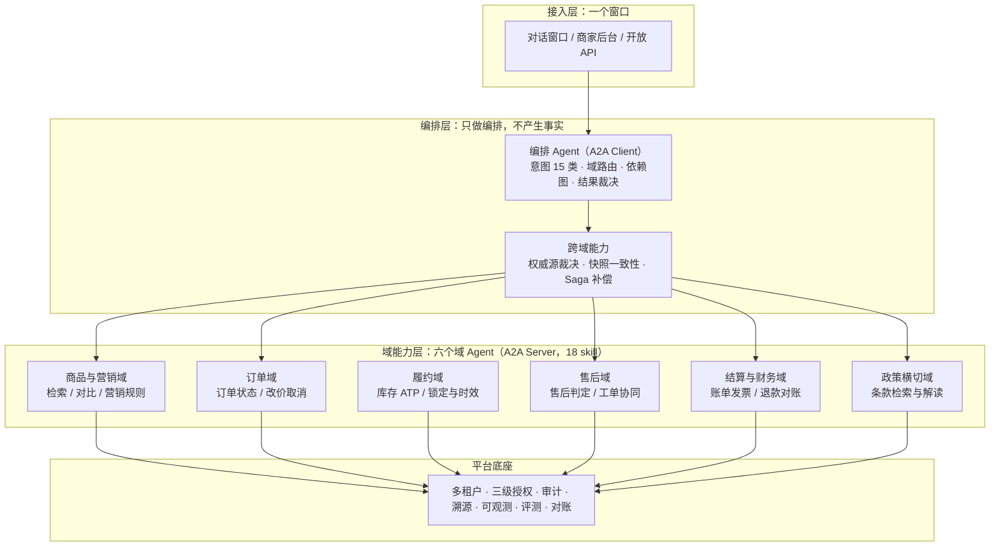
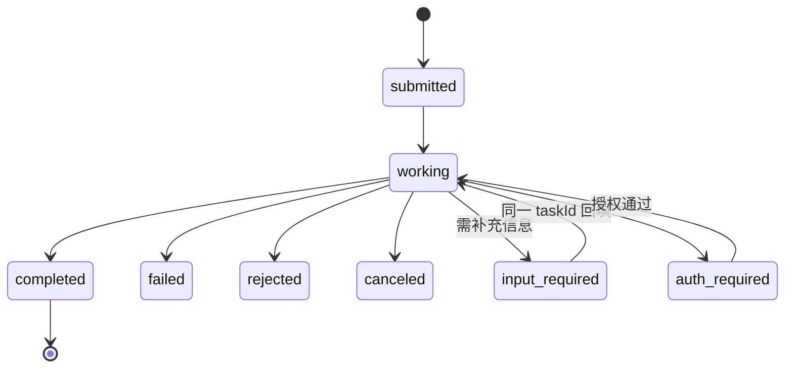
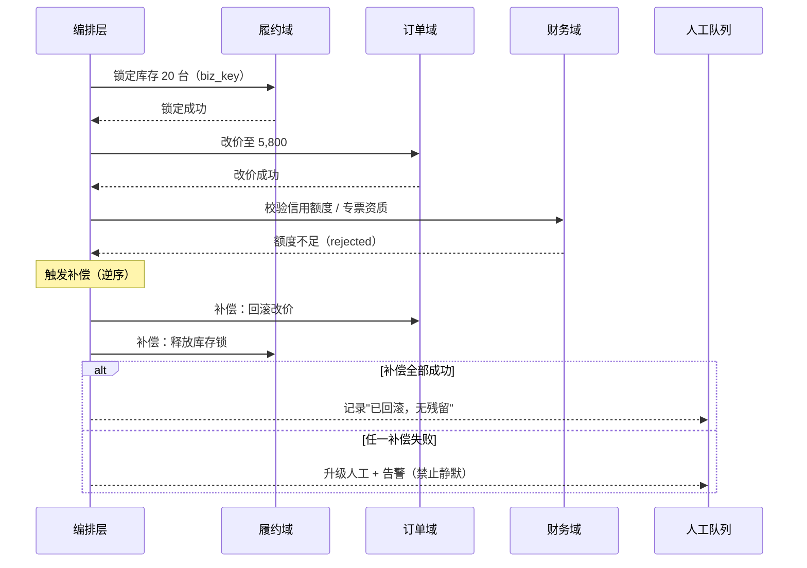

# AgentDock · 企业级 A2A 商家经营智能体中台 · 产品需求文档（PRD）

| 项目 | 内容 |
|---|---|
| 产品名称 | AgentDock |
| 产品定位 | 企业级 A2A（Agent-to-Agent）商家经营智能体中台：**一个对话入口，五个业务域，七个 Agent（1 编排 + 5 域 + 1 政策横切），18 个 skill** |
| 文档版本 | v2.2 |
| 文档状态 | 待评审 |
| 编制日期 | 2026-10-15 |
| 修订日期 | 2026-10-24（v2.2 订单/履约拆分 + 政策双形态；2026-10-20 v2.0 多业务域重构、v1.2 图侧回写、v1.1 A2A 规范对齐） |
| 目标读者 | 产品、研发、测试、运营、架构评审、外部评审 |

---

## 目录

1. [项目背景与定位](#1-项目背景与定位)
2. [痛点分析](#2-痛点分析)
3. [域地图与架构分层](#3-域地图与架构分层)
4. [产品目标与范围](#4-产品目标与范围)
5. [用户角色与场景](#5-用户角色与场景)
6. [核心功能需求](#6-核心功能需求)
7. [A2A 协作机制设计](#7-a2a-协作机制设计)
8. [企业级能力规格](#8-企业级能力规格)
9. [非功能需求](#9-非功能需求)
10. [数据需求](#10-数据需求)
11. [验收标准](#11-验收标准)
12. [里程碑与分期](#12-里程碑与分期)
13. [风险与假设](#13-风险与假设)

---

## 1. 项目背景与定位

### 1.1 背景

商家经营不是一条流水线，而是**四个彼此割裂却必须互相印证的系统**：商品与营销（有没有货、多少钱、能不能叠加）、订单与履约（到哪了、能不能改、几天到）、售后（能不能退、责任在谁）、结算与财务（多少钱、什么时候到账、开什么票）。

今天这四个系统各有各的客服：商品问题问导购，订单问题问订单客服，退款问题被转到财务，最后用户被转四次，每次都要重讲一遍。企业内部也一样——客服要回答一个问题，得同时打开五个后台，而他能看到的权限往往只覆盖其中两个。

大模型给了统一入口的可能性，但把四个域塞进一个 prompt 立刻出问题：权限无法隔离（客服能看订单就不能让他看成本价）、口径无法统一（营销算的优惠和财务算的应收对不上）、错误无法定位（答错了不知道该改哪个模块的规则）、审计无法落地（一次回答引用四个域的数据，责任无法界定）。

**这不是"换个更好的模型"能解决的问题，而是"谁来对哪个事实负责"的组织问题。** 多 Agent 的价值不在于 Agent 多，而在于它能把"谁负责哪个事实"写进架构。

### 1.2 产品定位

AgentDock 是一个 **企业级 A2A（Agent-to-Agent）商家经营智能体中台**。

**形态**：用户只看到一个对话窗口，输入「这批货退了，钱什么时候到？」，系统自动判断这句话要动售后、履约、财务三个域，按依赖顺序委托三个专家 Agent，最后用一个口径回答——并告诉用户哪一句话来自哪个域、哪一份单据。

**内核**：单一入口（编排）+ 业务域自治（专家 Agent）+ 协议对齐（A2A v1.0）+ 事实权威（唯一写者原则）。

**面向谁**：SaaS 交付给中大型商家（多租户），内部同时服务客服、运营、财务三类角色，可见范围按域隔离。

### 1.3 关键定位边界（重要）

**做什么（In Scope）：**

- **统一对话入口**：文本多轮，意图识别到 15 类，按域路由，跨域任务自动编排
- **五个业务域**：商品与营销、订单、履约、售后、结算与财务（**一域一个 Agent**，域内 2–4 个 skill）
- **一个横切域**：政策知识（被各业务域共用，不归属任何单一域；对外是子 Agent，对内提供只读检索 API，见 3.2）
- **跨域治理**：权威源裁决、快照一致性、Saga 补偿、跨域对账
- **企业级底座**：多租户、三级授权、审计、溯源、可观测、评测、运营

**不做什么（Out of Scope）：**

- ❌ 跨平台 / 跨 App 的自动比价与数据抓取（合规与反爬）
- ❌ 自动下单、自动支付、支付托管与资金授权链（资金合规）
- ❌ 真实资金操作：退款、改价、开票**只做查询与建议，不做真实写操作落地**（见 7.7 的补偿讨论——Saga 在 Mock 环境完整实现，生产环境仅给建议）
- ❌ 商家入驻生态与双边撮合
- ❌ 供应链协同域、客户会员域（后置，见 3.6）
- ❌ **语音输入**：本期仅文本；前端保留语音入口作为扩展点，不承诺转写能力，不纳入验收
- ❌ **外部客服 / 工单系统对接**：仅自建最小坐席台与站内接管（见 7.12）
- ❌ **真实物流轨迹**：物流类问题只答知识库中的配送/发货/运费说明与履约域的节点状态，不直连承运商

> **关于联网检索**：本期允许对**科普类、名词解释类**问题检索公开网络（FR-4.8，P2），但**禁止**抓取第三方平台的商品价格/库存用于比价，也**禁止**用网络信息替代本店的价格、库存、政策承诺。来源等级与判定规则见 7.11。

---

## 2. 痛点分析

痛点分三层：用户侧（C 端）、商家侧（B 端）、企业管理侧。第三层是「企业级」能力的真正落点，也是多业务域存在的理由。

### 2.1 用户侧痛点

| 编号 | 痛点 | 具体表现 | 影响 |
|---|---|---|---|
| U1 | 参数看不懂 | 商品页堆砌规格（i7-1360P / 16G / PCIe4.0），用户不知哪些指标与自己相关 | 决策困难，流失 |
| U2 | 选不出合适的那款 | 几十上百个 SKU，差异说不清 | 决策周期长，转化低 |
| U3 | 问不了「人话」问题 | 只能搜关键词，无法提问「我主要剪视频，6000 以内够用吗」 | 需求表达受阻 |
| U4 | 政策类问题靠翻网页 | 退货期限、保修年限散落在帮助页各处 | 找不到答案，求助客服 |
| U5 | **同一件事要问四个地方** | 退货要问售后、进度要问订单、钱要问财务，每次重讲一遍 | 体验断裂，投诉升级 |
| U6 | **不同客服给的答案不一致** | 售后说 7 天到账，财务说 15 个工作日 | 信任崩塌，纠纷凭证 |

> U5 / U6 是 v2.0 新增的核心痛点，也是多域设计的直接依据：**跨域一致性不是体验优化，是纠纷来源。**

### 2.2 商家侧痛点

| 编号 | 痛点 | 具体表现 | 影响 |
|---|---|---|---|
| M1 | 客服人力成本高 | 约 80% 咨询为重复问题（参数、库存、政策、状态） | 人力浪费在低价值问答 |
| M2 | 7×24 响应做不到 | 夜间与大促期间咨询无人响应 | 转化流失 |
| M3 | 问答质量不稳定 | 新客服答不准参数，误导用户 | 埋下售后纠纷 |
| M4 | 答错无人管、无法追责 | 无留痕记录，纠纷时查不到当时答复 | 责任无法界定 |
| M5 | **跨部门问答需要转接** | 售后不知道账期，订单不知道退款规则，客户被转四次 | 首响时长与解决率双降 |

### 2.3 企业管理侧痛点（企业级能力落点）

| 编号 | 痛点 | 具体表现 | 影响 |
|---|---|---|---|
| E1 | 知识散乱、更新滞后 | 商品、政策、售后文档分散各处，变更后客服不知情 | 答复过期信息 |
| E2 | 无权限管控 | 所有人可见全部知识，成本价、客户数据无隔离 | 数据安全风险 |
| E3 | 答复不可溯源 | 用户质疑「你凭什么这么说」时无法给出处 | 无法审计，无法举证 |
| E4 | 无法运营与衡量 | 不知道用户问什么、答得好不好、该补哪些知识 | 无法持续优化 |
| E5 | **域间口径不一致** | 营销的优惠规则与财务的应收口径各自维护，长期对不上 | 财务差错，对账成本高 |
| E6 | **职责边界不清导致重复建设** | 三个团队各做一个"退款进度查询"，三个答案 | 维护成本三倍，口径三个 |
| E7 | **合规责任落在人身上** | 谁答的、依据什么、有没有超范围承诺，事后无法证明 | 监管与被诉风险 |

> E5–E7 说明一件事：**多域不是把系统拆小，而是把责任划清。** 拆分的前提是每个域有唯一事实源（3.4），否则拆完只会多出三个互相矛盾的答案。

### 2.4 痛点—方案映射总览

| 痛点编号 | 解决方案 | 对应功能模块 |
|---|---|---|
| U1 | 参数通俗化解读 | 商品域 · `product.lookup` |
| U2 | 多商品对比 + 场景推荐 | 商品域 · `compare.matrix` |
| U3 | 自然语言多轮对话 | 入口层意图与槽位（6.1.1） |
| U4 | 政策知识库检索 | 政策横切域 · `policy.answer` |
| U5 | 跨域自动编排 | 域路由（7.5）+ 依赖图 |
| U6 | 权威源裁决 | 权威源矩阵（3.4）+ 7.6 |
| M1 | 自动应答覆盖重复问题 | 全域 Agent |
| M2 | 7×24 在线 | 无状态服务架构 |
| M3 | 检索增强，答案必须基于文档与数据 | RAG（6.6）+ 双阈值拒答 |
| M4 | 全链路审计 | 审计留痕（8.3） |
| M5 | 域间委托替代人工转接 | A2A 委托（7.3）+ 人机协同（7.12） |
| E1 | 统一知识库 + 按域维护 | 知识管理（FR-2.2） |
| E2 | 三级授权（租户 × 域 × skill） | 8.2 |
| E3 | 逐条来源 + 权威域标注 | 来源溯源（8.4） |
| E4 | 热问 / 未命中 / 转人工率看板 | 运营分析（8.7） |
| E5 | 唯一写者原则 + 日终对账 | 3.4 / 8.8 |
| E6 | 域划分与 skill 唯一归属 | 3.3 / 3.5 |
| E7 | 不可篡改审计 + 合规留痕 | 8.3 / 8.9 |

---

## 3. 域地图与架构分层

### 3.1 四层架构



> **一句话读法**：L2 不产生任何事实，只决定"去哪问、按什么顺序问、冲突时信谁"。所有事实来自 L3，所有约束来自 L4。这条边界一旦破（编排层自己算了个金额），权威源就名存实亡。

### 3.2 五个业务域

| 域 | 回答什么问题 | 它独占的权威数据 | 缺了会怎样 |
|---|---|---|---|
| **商品与营销** | 买哪款、参数什么意思、活动价怎么算、券能不能叠加 | 商品档案、类目属性、SKU 归属、挂牌价、活动与券规则 | 答不了“选哪个”，也答不了“这价怎么来的” |
| **订单** | 订单到哪了、能不能改价取消 | 订单状态机、成交价（**唯一写者**） | 所有“我的单子”类问题全部落空 |
| **履约** | 有没有货、几天到、能不能锁定库存 | 可售库存（ATP）、锁定数、时效承诺（**唯一写者**） | 所有“有没有货、多久到”类问题全部落空 |
| **售后** | 能不能退、责任在谁、怎么报修、备件多久到 | 退换修规则、工单、责任判定结果 | 客诉无处承接，只能全量转人工 |
| **结算与财务** | 账单多少、发票怎么开、退款何时到账、怎么对账 | 账单、发票、退款流水、信用额度 | **最容易出事故的域**：说错到账时间等于乱承诺 |

**政策横切域**：不归属任何业务域，被各业务域共用。它独占的是“经审核的政策文本 + 生效期”，任何域要引用政策都必须经它，不得各自存一份副本。

**政策双形态接入（v2.2）**：对外是 A2A 子 Agent（意图 13 直接路由、跨域并行委托、A2A 演示）；对内暴露**内部只读检索 API**，各域 Server 以“政策工具 client”（进程内调用，不建 Task，见 7.3.7）引用条款——权威文本与版本仍由政策 Agent 唯一持有，域内工具只读、不可落本地副本。

### 3.3 七个 Agent 与十八个 skill

**先纠正一个拆分错误（v2.1）**：v2.0 把每个 skill 都拆成了独立 Agent（10 个），本质是**把 A2A 的 skill 层误当成了 Agent 层**——A2A 的 Agent Card 自带 `skills[]`，一个 Agent 声明多个 skill 是规范的推荐用法，不需要一个 skill 起一个进程。按“这堆东西是不是真的各管一摊数据、各有各的故障域”重新量一遍，收敛为域 Agent + 编排 Agent（v2.1 为 5 域 + 1 编排；**v2.2 按同一把尺子把“订单与履约”拆为订单、履约两个域 Agent**，见 3.5），18 个 skill 挂在各自的 Card 下。

**Agent 表（部署单元 = 7）**

| # | Agent | 协议角色 | 域 | Card 声明的 skill | 独占的权威数据 |
|---|---|---|---|---|---|
| 1 | 编排 Agent | A2A Client | 编排层 | 无对外 skill | **无任何业务数据**，只持路由表与依赖图 |
| 2 | 商品与营销 Agent | A2A Server | 商品与营销 | `product.retrieve` / `product.lookup` / `compare.matrix` / `promo.evaluate` | 商品档案、SKU 归属、挂牌价、活动与券规则（只读） |
| 3 | 订单 Agent | A2A Server | 订单 | `order.query` / `order.amend` | 订单状态机、成交价（**唯一写者**） |
| 4 | 履约 Agent | A2A Server | 履约 | `fulfill.atp` / `fulfill.track` | ATP 可售量、锁定数、时效承诺（**唯一写者**） |
| 5 | 售后 Agent | A2A Server | 售后 | `aftersale.eligibility` / `aftersale.reason` / `ticket.create` / `ticket.query` | 退换修资格与责任判定（**唯一写者**）、工单与备件 |
| 6 | 结算与财务 Agent | A2A Server | 结算与财务 | `billing.statement` / `invoice.issue` / `refund.status` / `refund.settle` | 账单、发票、退款流水与到账时间（**唯一写者**） |
| 7 | 政策知识 Agent | A2A Server | 横切 | `policy.answer` / `policy.clause` | 政策文本、版本、生效期（只读；另对内提供只读检索 API，见 3.2） |
| — | 人工坐席 Agent（P1） | A2A Server | 横切 | `handoff.accept` | 无，接管与回流 |

**skill 表（能力单元 = 18，写权限与补偿在这一层细分）**

| 域 | skill | 写操作 | 补偿动作（7.7） | 失败影响 |
|---|---|---|---|---|
| 商品与营销 | `product.retrieve` / `product.lookup` | 否 | — | 少一个候选，主链路可继续 |
| 商品与营销 | `compare.matrix` | 否 | — | 对比缺席，**只消费候选集 Artifact**，不二次拉参 |
| 商品与营销 | `promo.evaluate` | 否 | — | 到手价标注“待财务确认” |
| 订单 | `order.query` | 否 | — | 状态类问题转人工 |
| 订单 | `order.amend` | 是（Mock） | **撤销改价**（幂等键） | 拒答“改价”，不得口头承诺 |
| 履约 | `fulfill.atp` | 是（锁定/释放） | **释放锁定** | 拒答“有没有货”，不得估库存 |
| 履约 | `fulfill.track` | 否 | — | 状态类问题转人工 |
| 售后 | `aftersale.eligibility` / `aftersale.reason` | 否 | — | 只答流程，不答资格 |
| 售后 | `ticket.create` | 是（Mock） | **撤单/作废工单** | 告知"建单失败"，不重复建 |
| 结算与财务 | `billing.statement` / `refund.status` | 否 | — | **金额与到账时间必须拒答**（不猜） |
| 结算与财务 | `invoice.issue` | 是（Mock） | **冲红/作废** | 拒答"能开专票" |
| 结算与财务 | `refund.settle` | 是（Mock） | **退回原状态并对账** | 升级人工，禁止静默 |
| 政策 | `policy.answer` / `policy.clause` | 否 | — | 只答"未找到生效条款" |

> **为什么 skill 要细分、Agent 反而不细分**：细分的目的是**权限与补偿的粒度**，不是进程数量。两者不在同一层就能同时拿到——scope 按 skill 发放（`product.*` 与 `refund.*` 是两张令牌），补偿按 skill 声明（`order.amend` 的补偿是撤价，`ticket.create` 的补偿是作废工单），但部署、发现、评测仍以域 Agent 为单位。
>
> 反过来，把 skill 升成 Agent 的代价是实打实的：部署单元 +4、Card 发现 +4、跨域 trace 多 4 跳、每个都要独立评测集——**换来的只是名字更像"多 Agent"**。

**Agent 边界判定四问**（新增 Agent 前先过，满足 2 条以上才独立部署）

1. 是否独占一份权威数据？（只能它写，别人只能引用）
2. 是否有独立的故障域与降级口径？（财务挂了必须"拒答到账时间"，商品挂了只需"少个推荐"）
3. 是否需要自主决策（多步推理、自然语言判定），而非确定性 API？
4. 是否有独立的发布节奏与责任团队？

**按住这把尺子回量 v2.0 的 10 个 Agent**：商品对比（无独占数据）、营销规则（确定性规则函数）、工单协同（决策浅）、账单发票（决策浅但对账敏感）四个落在 skill 层；四个业务域各收敛为 1 个域 Agent（商品检索+对比+营销规则 → 商品与营销；订单+库存履约 → 订单与履约；售后判定+工单协同 → 售后；账单发票+退款对账 → 结算与财务），加政策横切 1 个，共 5 个。这也修掉了 v2.0 的一处自相矛盾——原文一边写“商品对比 Agent 无独占数据”，一边把它算作独立 Agent。

**v2.2 追加**：同一把尺子也把 v2.1 的“订单与履约”拆开了——两者独占数据不同（订单状态机/成交价 vs ATP/锁定数/时效）、降级口径不同（订单挂拒答“单子状态”，履约挂拒答“有没有货”），满足边界判定四问中的 3 条，故各为独立域 Agent；拆完后 7.5 的 `[order, fulfillment]` 并行边、3.4 的双权威、10.5 的六值 domain 枚举才与部署单元一一对应。代价是“改价 + 锁库存”类 Saga 多一条跨域边，由 7.7 的补偿表与幂等键承接。

### 3.4 权威源矩阵（本方案的核心约束）

**唯一写者原则**：每个事实只有一个 Agent 有计算权与写权，其他 Agent 只能引用它的 Artifact，不得自己算一遍。

| 事实 | 权威 Agent | 其他 Agent 的权限 | 冲突时 | 典型错法 |
|---|---|---|---|---|
| 商品规格 / SKU 归属 | 商品与营销 | 只能引用 `art_candidate` 快照 | 以商品档案版本为准 | 对比 skill 二次拉参，导致两处规格不一致 |
| 挂牌价 | 商品与营销 | 只读 | 以商品档案为准 | 营销 skill 自己算原价 |
| 成交价 / 改价后价格 | 订单 | 只读 | **以订单为准** | 营销算出“到手价”当成成交价 |
| 可用库存（ATP）/ 锁定数 | 履约 | 商品 Agent 只展示“参考库存” | 以 ATP 为准 | 商品详情页库存与真正可售量不一致 |
| 时效承诺 | 履约 | 只读 | 以履约配置为准 | 政策文档的时效说明被当成仓配承诺 |
| 订单状态 | 订单 | 履约只提供节点时间 | 以订单状态机为准 | 物流节点当成订单状态 |
| 退换修资格 / 责任 | 售后 | 只读 | 以判定结果为准 | 财务自己判断能不能退 |
| 退款金额 | 结算与财务 | 售后只给“可退资格” | **以退款单为准** | 售后按支付金额算，忘了扣券与运费 |
| 到账时间 | 结算与财务 | **任何 Agent 不得推测** | 无数据即拒答 | 政策文档的“7–15 个工作日”被当成个案承诺 |
| 发票状态 / 可开额度 | 结算与财务 | 只读 | 以税务系统回执为准 | 客服口头承诺“能开专票” |
| 政策条款内容 | 政策知识 | 只读，且必须带版本与生效期 | 以生效版本为准 | 各域各自存一份政策副本 |

> 这张表是整个 v2.0 最重要的一页。它决定了三件事：**跨域冲突有唯一解**（不靠模型调和）、**审计能定位责任**（这个数字是谁给的）、**测试有明确断言**（冲突场景必须输出权威方口径，见 AC-22）。

### 3.5 域边界判定原则

新增一个域之前，先过这三问，任一为否就不该成域：

1. **它是否独占某类权威数据？** 若无（如"商品对比"），它只是别的域里的一个 skill。
2. **它是否有独立的权限边界？** 若无（客服本就能看订单和售后），合并比拆开省一半协调成本。
3. **它失败时的影响面是否与其他域不同？** 财务域挂了必须"拒答到账时间"，商品域挂了只需"少一个推荐"——影响面不同才值得独立降级。

**已按此原则裁掉的两个候选域**：

- **对比域**：无独占数据、无独立权限、失败影响与商品域相同 → 降为商品与营销域的 skill（`compare.matrix`）。
- **物流域**：真实轨迹不在范围内，剩下的“时效说明”属于履约的 ATP 与知识库 → 并入履约域（v2.1 时并入订单与履约域，v2.2 拆分后归履约）。

**v2.2 按同一把尺子拆开的一个域**：

- **订单与履约 → 订单域 + 履约域**：四问各得 3 分——①独占数据不同（订单状态机/成交价 vs ATP/锁定数/时效承诺）；②故障域与降级口径不同（履约挂 → 拒答“有没有货”，订单挂 → 拒答“单子状态”，二者是独立状态机、独立数据源）；③都需要判定（可否改价、可否承诺时效）；④库存与价格联动频率远高于订单状态机变更，发布节奏不同。拆完后“一域一 Agent”严格成立，3.4 权威矩阵、7.5 路由表、10.5 域枚举三处不再打架。

### 3.6 后置域（本期不做，但路由表留位）

| 域 | 为何后置 | 接入成本（评估） |
|---|---|---|
| 供应链协同 | 需采购单、供应商交期数据，Mock 成本高；对 C 端问答价值间接 | 新增 1 个域 Agent（2–3 个 skill）+ 1 列路由表，不动编排代码 |
| 客户与会员 | 容易滑成 CRM 项目，且涉及更敏感的客户数据 | 新增 1 个域 Agent + 画像字段扩展 |

> 后置不等于不设计：路由表按"域集合"表达（见 7.5），新增域是加一行数据，不是改编排逻辑——这是 AC-28 要验的东西。

---

## 4. 产品目标与范围

### 4.1 产品目标

| 层级 | 目标 | 衡量指标 |
|---|---|---|
| 业务目标 | 一次对话解决跨域问题 | **跨域任务一次解决率 ≥ 70%**（无需转人工、无需二次问） |
| 业务目标 | 降低重复问答负担 | 重复问题自动解决率 ≥ 60% |
| 业务目标 | 口径统一 | **跨域口径冲突导致的客诉 ≤ 1 件/月**（以对账差异为前置信号） |
| 技术目标 | 答案可溯源、无幻觉 | 非拒答答案引用覆盖率 100%；来源等级标注 100%；faithfulness ≥ 95% |
| 技术目标 | 编排确定性 | 同一意图 + 槽位，路由结果 **100% 一致**（不依赖模型自由发挥） |
| 技术目标 | 域可扩展 | 新增一个域仅新增配置与 Card，**不改编排代码** |
| 治理目标 | 权限到位 | 跨域越权拦截 100%，行级数据权限（只能查自己的单）100% |
| 产品目标 | 展示 A2A 多 Agent 协作 | 协作链路可观测、可回放、可演示 |

### 4.2 范围界定

**In Scope（本期实现）：**

| 模块 | 说明 |
|---|---|
| 统一入口 | 文本多轮问答、意图与槽位、域路由、跨域编排、答案与来源展示 |
| 五个业务域 + 一个横切域 | 6 个域 Agent / 18 个 skill，覆盖 13 类委托意图 |
| 跨域能力 | 权威源裁决、快照一致性、Saga 补偿（Mock 环境完整）、跨域对账、部分交付 |
| 商家后台 | 商品库、知识库、订单/退款只读视图、问答日志、未命中处理 |
| A2A 协作层 | Agent Card、能力发现、委托、Task 生命周期、Trace |
| RAG 引擎 | 混合检索、引用溯源、双阈值拒答、查询改写 |
| 企业级治理 | 多租户、三级授权、审计、可观测、评测、运营分析、合规留痕 |

**Out of Scope：** 见 1.3。

### 4.3 域分期

| 阶段 | 域 | 说明 |
|---|---|---|
| 核心五域（本期） | 商品与营销、订单、履约、售后、结算与财务 | 跨域链路完整可演示 |
| 横切（本期） | 政策知识 | 被各业务域共用（双形态，见 3.2） |
| 后置 | 供应链协同、客户与会员 | 路由表留位，不进本期验收 |

### 4.4 方案对比与取舍（为什么不是单 Agent）

这是整份文档最该被追问的一节，所以在需求阶段就给出对比与结论，而不是留到评审现场解释。

**baseline：单 Agent + 8 个工具**（检索、对比、政策、订单、库存、退款、开票、转人工），全部逻辑塞进一个 system prompt，数据权限在工具层拦截。

| 维度 | 单 Agent + 工具 | 5 域 / 7 Agent（本方案） | 差异性质 |
|---|---|---|---|
| 首字延迟 | 1 次生成 ≈ 1.2s | 单域 ≈ 1.8s；三域串行 ≈ 2.7s | 多 0.5–1.5× |
| 单轮 token | 3.4k in / 1.0k out | 4.1k in / 1.2k out（加权） | 多约 1.2× |
| 权限隔离 | 靠工具层 if/else，随工具数增长失控 | 按域 + skill 的令牌 scope，天然隔离 | **质变** |
| 口径一致 | 无法保证（同一 prompt 里两套规则会互相污染） | 权威源矩阵强约束 | **质变** |
| 可测性 | 一个巨型 prompt，答错无法定位 | 每域独立评测集与单测 | **质变** |
| 演进 | 加一个域 = 重写 prompt，回归全量 | 加域 = 加 Card + 路由行 | 质变 |
| 故障隔离 | 单点，工具超时即整条失败 | 域级降级，部分交付 | 质变 |
| 实现成本 | 低（1 周） | 高（域边界定义 + 补偿 + 对账） | 多约 3–4 倍 |

**结论（写进文档，而不是心里知道）**：

1. **单域请求走单 Agent 路径。** 约 60% 的请求只涉及一个域（参数、政策、订单状态），这些请求不启多 Agent 流程，直接单次委托 + 汇总。这样延迟与成本接近 baseline，却已拿到域级权限。
2. **多 Agent 只为跨域存在。** 剩下约 40% 的跨域请求（退款、改价开票、活动叠加）才需要编排、权威裁决与补偿——**这些能力在单 Agent 里根本无法表达**，因为单 Agent 没有"谁说了算"的概念。
3. **判据不是"够不够酷"，而是"权限与责任能不能落地"。** 若本产品只服务 C 端单一品类导购，我会选单 Agent；一旦出现财务域与客服角色，多域就是必然——不是因为技术先进，而是因为**越权与错承诺的代价高于那 1.5 倍延迟**。

> 这一段是三年与五年的分水岭：三年能画出多 Agent 架构图，五年能说清"哪里不该多 Agent"。

---

## 5. 用户角色与场景

### 5.1 角色定义

| 角色 | 说明 | 主要诉求 | 可见范围（域级） |
|---|---|---|---|
| 消费者（C 端） | 平台最终用户 | 快速得到跨域一致的答案 | 仅自己的订单/退款 + 公开商品与政策 |
| 客服人员 | 商家客服 | 查看问答记录、接管疑难 | 售后域 + 订单域（只读），**不含财务域** |
| 财务人员 | 结算岗 | 核对退款、发票、账期 | 财务域 + 订单域（只读） |
| 商家运营 | 商品与知识维护 | 维护商品库、知识库、活动规则 | 商品域 + 政策域（可编辑） |
| 平台管理员 | 平台方 | 租户管理、权限配置、全局监控 | 全平台（脱敏） |

> 角色不再按"菜单"划分，而是按**域**划分——这是多域带来的第一个直接变化（落地见 8.2）。

### 5.2 关键用户场景

**场景 1：场景化选购（单域）**

> 「我主要用来剪视频，预算 6000 以内，推荐一台」
> 域路由：仅商品域 → 检索 + 对比 → 推荐 3 款 + 理由 + 来源

**场景 2：参数答疑（单域）**

> 「这两款的内存有什么区别，我该选哪个？」
> 域路由：仅商品域 → 消费候选 Artifact → 归一化对比 → 通俗解读

**场景 3：政策咨询（横切单域）**

> 「这个能退吗？保修几年？」
> 域路由：政策域 → 按型号命中条款（版本 + 生效期硬过滤）→ 带来源回答

**场景 4：退款到账（三域串行）**

> 「这批货退了，钱什么时候到？」
> 域路由：售后（资格）→ 履约（是否入库）→ 财务（金额与到账时间）
> 输出：「符合 7 天无理由，已入库，退款 1,299 元已于 10-19 发起，预计 10-22 前到账（财务口径）」

**场景 5：改价开票（四域：并行 + 串行 + 补偿）**

> 「客户要 20 台，能改价并开专票吗？」
> 域路由：商品（型号与货源）**头部并行**；履约（锁库存）→ 订单（改价）→ 财务（信用额度与专票资质）**串行 3 跳**（v2.2 拆分后商品并行在前，不破深度上限）
> 异常：财务判定额度不足 → 触发补偿：释放库存锁、回滚改价 → 输出「可改价但额度不足，建议先回款」

**场景 6：客服接管（人机协同）**

> AI 判定低置信或高风险 → 交接包（5 字段）→ 客服在自己有权域内接管 → 答复审核后回流知识库

**场景 7：运营补知识（闭环）**

> 运营查看未命中榜 → 按"触发原因"分组 → 补一条售后条款 → 入库 → 回归评测 → 生效

### 5.3 跨域场景矩阵（路由表的需求来源）

| 用户一句话 | 涉及域 | 依赖类型 | 若按单域回答会怎样 |
|---|---|---|---|
| 这批货退了，钱什么时候到？ | 售后 + 履约 + 财务 | **串行依赖** | 售后一句"7 天到账"，与财务口径冲突 |
| 活动价能叠加店铺券吗？到手多少？ | 商品（营销）+ 财务 | **仲裁** | 营销说"能叠"，结算金额却对不上 |
| 客户要 20 台，改价并开专票 | 商品（并行）+ 履约 + 订单 + 财务 | 并行 + 串行 + **补偿** | 改价成功但额度不足，库存白锁 |
| 订单能取消吗？会退款吗？ | 订单 + 售后 + 财务 | 串行 | 只说"能取消"，不说"钱怎么退" |
| 发票开错了能重开吗？影响退款吗？ | 财务 + 售后 | 并行 + 仲裁 | 财务说重开，售后说影响退款，互相矛盾 |
| 这台机器坏了，保修内还是保外？ | 售后 + 政策 + 商品 | 并行汇总 | 少了购买日期与型号，判定不了 |

> 这张矩阵是 7.5 路由表的原始输入：**每一条都要在 PRD 里有确定的域集合与依赖类型**，否则研发只能靠模型自由编排——那就等于没有设计。

---

## 6. 核心功能需求

> 优先级：P0 = MVP 必须；P1 = 完整版必须；P2 = 增强项。
> 编号规则：FR-1 入口、FR-2 后台、FR-3 A2A、FR-4 RAG、FR-5 治理、**FR-6 域能力（v2.0）**、**FR-7 跨域编排（v2.0）**。

### 6.1 统一入口（FR-1）

| 编号 | 功能点 | 描述 | 优先级 |
|---|---|---|---|
| FR-1.1 | 自然语言问答 | 用户以自然语言提问，系统识别意图与槽位后作答 | P0 |
| FR-1.2 | 多轮对话 | 支持上下文延续（如追问「那这个便宜点的呢」） | P0 |
| FR-1.3 | 场景化推荐 | 依据使用场景与预算推荐匹配商品 | P0 |
| FR-1.4 | 商品对比 | 多商品参数并列对比并通俗解读；**字段名与单位先归一**（「16G」与「16GB」视为同项），缺失配置**标注「无此配置」，绝不推断填补** | P1 |
| FR-1.5 | 答案来源展示 | 每条结论展示来源文档或数据时点，并标注**权威域** | P0 |
| FR-1.6 | 兜底与转人工 | 低置信或拒答时先给替代路径（缩小范围 / 换问法 / 转人工入口）；**用户明确要求或反复碰壁才转人工** | P1 |
| FR-1.7 | 会话历史 | 用户可查看历史会话（跨域任务显示为一条，内含多域明细） | P2 |
| FR-1.8 | 输入安全 | 输入与检索内容一律视为不可信数据：①入口拦截（注入特征、长度上限、敏感词、越权意图）②系统提示与用户内容结构隔离 ③工具调用白名单 ④输出侧校验；不通过直接拒答、不进入下游；附问题规范化（纠错 / 全半角统一 / 口语补全） | P0 |
| FR-1.9 | 答案反馈 | 赞 / 踩 / 纠错；负反馈进**人工复核队列**（不当训练真值）；接口做频次限流与异常检测 | P1 |
| FR-1.10 | 跨域答案合成 | **v2.0 新增**：多域 Artifact 合成一个答案，同一事实只出现一次且只采用权威域口径；冲突不并列呈现（不写"售后说 7 天、财务说 15 天"） | P0 |
| FR-1.11 | 分阶段交付 | **v2.0 新增**：串行链路超过 2 跳时先输出已确定部分（如"符合退货条件"），后续域结果到达后增量补齐，避免用户等 3s 看空屏 | P1 |

#### 6.1.1 理解层：意图与槽位（FR-1.1 的实现规格）

> 这一节定义"系统怎么判断用户想干什么、要动哪几个域"。它是路由、委托、澄清、验收的共同前提。

**（1）意图体系：13 类委托意图 + 2 类本地意图**

意图是跨域编排的入口。分类错误会把任务派给错误的域，比答错更严重——答错可以纠正，派错域会给出"看起来对但口径错"的答案。

| # | 意图 | 典型问法 | 目标域 | 目标 skill | 依赖类型 |
|---|---|---|---|---|---|
| 1 | 选购推荐 | 我主要剪视频，预算 6000，推荐一台 | 商品 | `product.retrieve` + `compare.matrix` | 并行（同域） |
| 2 | 商品对比 | 这两款内存有啥区别，该选哪个 | 商品 | `compare.matrix` | 单域 |
| 3 | 参数解读 | i7-1360P 是什么意思 | 商品 | `product.lookup` | 单域 |
| 4 | 营销优惠 | 活动价能叠加店铺券吗，到手多少 | 商品 + 财务 | `promo.evaluate` | **仲裁** |
| 5 | 订单查询 | 我的单到哪了，什么时候发货 | 订单 + 履约 | `order.query` + `fulfill.track` | 并行 |
| 6 | 订单变更 | 这单能改地址 / 取消吗 | 订单 + 履约 | `order.amend` | 串行（含补偿） |
| 7 | 库存时效 | 有货吗，几天能到 | 履约 | `fulfill.atp` | 单域 |
| 8 | 退换货 | 这个能退吗，拆了还能退吗 | 售后 + 履约 + 财务 | `aftersale.eligibility` | **串行** |
| 9 | 报修工单 | 坏了，怎么报修 | 售后 | `ticket.create` | 单域 |
| 10 | 售后进度 | 我上周报的修，师傅什么时候来 | 售后 | `ticket.query` | 单域 |
| 11 | 账单发票 | 这个月账单多少，能开专票吗 | 财务 | `billing.statement` + `invoice.issue` | 单域 |
| 12 | 退款到账 | 退了钱什么时候到账 | 售后 + 履约 + 财务 | `refund.status` | **串行** |
| 13 | 政策咨询 | 保修几年，运费谁出 | 政策（横切） | `policy.answer` | 单域 |
| 14 | 会话控制 | 换一个推荐 / 刚才那个再讲一遍 | **不委托** | —（`no-skill`） | — |
| 15 | 闲聊越界 | 你好 / 今天天气如何 | **不委托** | —（`no-skill`） | — |

> `no-skill` 两类不产生 Task，不计入委托成功率分母。

**（2）三类槽位（不要混为一谈）**

| 槽位类型 | 内容 | 来源 | 规则 |
|---|---|---|---|
| **语义槽位** | 品类、型号、使用场景、预算、品牌、时间范围 | 从语言抽取 | 可缺失，缺失按必填性澄清 |
| **事实槽位** | 订单号、退款单号、工单号、发票抬头 | 用户提供 **+ 系统校验** | **用户提供的单号只作过滤条件，必须与登录态下的单据列表取交集**；不在列表内直接拒绝并提示 |
| **系统槽位** | `tenant_id`、`customer_id`、`scope`、`snapshot_id` | 鉴权上下文 / 编排层生成 | **禁止从自然语言获取**，禁止信任请求体 |

> 这张表是跨域安全的第一道闸。典型错法：从用户输入里正则抽订单号，然后直接查库——那是越权漏洞，不是功能。**"这单是不是你的"只能由 token 回答。**

**（3）槽位必填判定**

| 槽位 | 适用意图 | 必填 | 缺失时行为 |
|---|---|---|---|
| 品类 / 型号 | 1、2、3、7、8、9 | 是 | 触发澄清（"你想看笔记本还是台式机？"） |
| 使用场景 | 1、2 | 是 | 触发澄清（"主要用来做什么？办公、剪辑还是游戏？"） |
| 预算 | 1、4 | 条件必填 | 触发澄清，或按品类价格分布给区间选项 |
| 订单号 | 5、6、8、12 | 是 | **列出该客户最近 3 单让其点选**，不让用户手打 |
| 时间范围 | 10、11 | 否 | 默认本月 |
| 发票类型 | 11 | 是 | 澄清（普票 / 专票），专票需资质校验 |
| 品牌偏好 | 1、2 | 否 | 不追问，不做过滤 |

**（4）置信度口径与阈值**

- 分类器对 15 类各给一个概率，**取 top-1 概率即置信度**。
- 阈值默认区间 **0.6 ~ 0.8**，在标注集上按「准确率—澄清率」曲线标定，**可按租户配置**。
- 判定：`≥ 阈值` → 直接路由；`< 阈值` → **不猜**，转澄清（协议上表现为 Task 进入 `input-required`，见 7.3.2）。
- 置信度随委托透传（`metadata.intent_confidence`），供下游与审计追溯。
- **跨域意图单独设阈值**：涉及财务的 4 / 8 / 12 三类误判代价最高（会把"能不能退"答成"什么时候到账"），阈值上浮 0.05–0.1。

**（5）澄清的终止条件**

- 同一 `contextId` 下**最多澄清 1 次**。
- 澄清必须给 **top-2 候选意图**作为可点选项，不做开放式追问。
- 补充后仍低置信 → **降级**为按 top-1 作答并显式标注不确定，同时计入低置信监控与转人工率。
- 涉及财务域的低置信**不允许降级作答**，直接转人工——错承诺的代价高于转人工成本。

**（6）偏好建模（用户画像）**

- **写入时机**：仅在高置信判定后写入，避免把误解固化。
- **作用方式**：只做检索结果的**排序加权，不做硬过滤**；保留约 10% 探索性推荐，防止信息茧房。
- **可撤销**：提供"重置偏好"入口；画像随会话与租户隔离，不跨租户复用。

### 6.2 业务域能力（FR-6）

| 编号 | 功能点 | 描述 | 优先级 |
|---|---|---|---|
| FR-6.1 | 商品检索与参数 | 结构化硬过滤（品类、价格区间、场景标签）+ 参数解释；剔除下架与无货 | P0 |
| FR-6.2 | 商品对比 | 消费候选 Artifact，输出归一化对比矩阵；缺失标"无此配置" | P1 |
| FR-6.3 | 营销规则 | 活动 / 券 / 叠加规则计算，输出"可用优惠"与"到手价估算"，**标注为估算，成交价以订单为准** | P1 |
| FR-6.4 | 订单查询 | 订单状态机 + 成交价 + 可执行动作（能否取消/改址/改价） | P0 |
| FR-6.5 | 订单变更 | 改价 / 改址 / 取消（Mock 写操作）；**必须先锁库存再改单**，失败走补偿 | P1 |
| FR-6.6 | 库存与时效 | ATP 可售量、分仓、时效承诺；**不承诺未配置的时效** | P1 |
| FR-6.7 | 售后资格判定 | 按型号 + 购买时间 + 政策条款 + 责任判定，输出"可退/不可退 + 依据条款" | P0 |
| FR-6.8 | 工单协同 | 建单 / 查进度 / 备件与上门排期（Mock） | P1 |
| FR-6.9 | 账单与发票 | 账单明细、可开额度、票种资质校验 | P1 |
| FR-6.10 | 退款与对账 | 退款金额、到账时间、退款流水、对账差异；**到账时间无数据即拒答** | P1 |
| FR-6.11 | 政策知识 | 条款检索与解读；版本 + 生效期硬过滤；禁止类推适用 | P0 |
| FR-6.12 | 域能力注册 | 每个域以 Agent Card 声明 skill 与权威数据；注册中心仅作缓存与策展 | P0 |

### 6.3 跨域编排（FR-7）

| 编号 | 功能点 | 描述 | 优先级 |
|---|---|---|---|
| FR-7.1 | 域路由 | 意图 + 槽位 → **域集合 + 依赖图**；由静态路由表驱动，同一输入结果 100% 确定，**不允许模型自由编排**（详见 7.5） | P0 |
| FR-7.2 | 权威源裁决 | 跨域结果冲突时按权威源矩阵（3.4）输出唯一口径，并在答案中标注权威域（7.6） | P0 |
| FR-7.3 | 跨域快照 | 一次任务生成 `snapshot_id`，各域 Artifact 带 `as_of`；偏差超阈值时重新拉取或标注"数据时点不一致"（7.8） | P1 |
| FR-7.4 | 跨域补偿 | 变更类跨域任务按 Saga 编排：每个写操作配补偿动作，幂等键去重，补偿失败升级人工并告警（7.7） | P1 |
| FR-7.5 | 跨域权限与最小化 | 三级授权 + 行级数据权限；敏感字段在进入 LLM 上下文前脱敏；越权返回 `rejected`（8.2） | P0 |
| FR-7.6 | 部分交付 | 部分域失败时输出可答部分 + 明确缺失项与原因，**绝不整条链路挂死，也绝不猜**（7.8） | P0 |
| FR-7.7 | 跨域对账 | 日终比对订单/退款/账单三方金额与时点，差异分类并进看板（8.8） | P2 |
| FR-7.8 | 域扩展 | 新增域仅新增 Card + 路由表行 + 知识，不改编排代码（验收 AC-28） | P2 |

### 6.4 商家管理后台（FR-2）

| 编号 | 功能点 | 描述 | 优先级 |
|---|---|---|---|
| FR-2.1 | 商品库管理 | 商品增删改查，含参数、价格、库存字段 | P0 |
| FR-2.2 | 知识库管理 | 文档上传、解析、分段、入库、版本与失效（按域归档） | P0 |
| FR-2.3 | 问答日志查看 | 按域过滤查看问答记录、来源与权威域标注 | P1 |
| FR-2.4 | 未命中问题处理 | 未命中列表（含触发原因）→ 补知识 → 回归 | P1 |
| FR-2.5 | 商品批量导入 | CSV / Excel 导入 | P2 |
| FR-2.6 | 知识生效预览 | 入库后预览检索效果 | P2 |
| FR-2.7 | 订单 / 退款只读视图 | 客服域可看订单与退款进度，**不含金额明细与信用额度**（行级脱敏） | P1 |
| FR-2.8 | 跨域任务复盘 | 按 `contextId` 查看一次跨域任务的域链、各域 Artifact、裁决过程 | P1 |

### 6.5 A2A 协作层（FR-3）

| 编号 | 功能点 | 描述 | 优先级 |
|---|---|---|---|
| FR-3.1 | Agent Card 发布与注册 | 发布签名 Card（规范）+ 登记注册中心（扩展，便于治理） | P0 |
| FR-3.2 | 能力发现 | 按 host 拉取并验签 Card，解析 skills 完成能力匹配 | P0 |
| FR-3.3 | 任务委托 | `SendMessage` 建 Task，`contextId` 贯穿多轮 | P0 |
| FR-3.4 | 多 Agent 协作 | 跨域任务按依赖图并行 / 串行编排 | P0 |
| FR-3.5 | 协作链路追踪 | 记录并可视化调用链（含域归属） | P1 |
| FR-3.6 | Agent 能力扩展 | 动态注册新专家 Agent | P2 |

### 6.6 RAG 引擎（FR-4）

| 编号 | 功能点 | 描述 | 优先级 |
|---|---|---|---|
| FR-4.1 | 文档解析与分段 | 多格式解析；**按条款 / 参数块切分**（政策按条、商品走结构化字段），单块 200~500 token，块间保留 overlap | P0 |
| FR-4.2 | 向量化与入库 | 向量化写入 Milvus（按租户 + 域分区） | P0 |
| FR-4.3 | 混合检索 | 向量 + 关键词融合召回（融合与精排选型见《RAG 技术方案》） | P0 |
| FR-4.4 | 重排序 | 召回结果重排 | P1 |
| FR-4.5 | 引用溯源 | 生成时绑定来源文档与片段位置 | P0 |
| FR-4.6 | 拒答机制 | **双阈值**（召回分数 + 生成置信度）任一不达标即拒答；拒答须说明"缺哪一类"，给替代路径 | P0 |
| FR-4.7 | 来源分级标注 | 每条结论标注来源等级（L0–L3）与权威域，前端分级呈现 | P1 |
| FR-4.8 | 联网补充检索 | 仅科普 / 名词解释；价格、库存、政策**禁止**使用；须标注"网络信息，未经商家确认" | P2 |
| FR-4.9 | 查询改写 | 检索前做**指代消解**与同义扩展；**这是 FR-1.2 能成立的工程前提** | P1 |

### 6.7 企业级治理（FR-5，详见第 8 章）

| 编号 | 功能点 | 描述 | 优先级 |
|---|---|---|---|
| FR-5.1 | 多租户隔离 | 租户间数据与知识完全隔离 | P1 |
| FR-5.2 | 三级授权 | 租户 × 域 × skill，叠加行级数据权限 | P1 |
| FR-5.3 | 审计留痕 | 全量问答 + 操作日志，可导出、不可改 | P0 |
| FR-5.4 | 来源溯源 | 引用可定位到文档、版本与数据时点 | P0 |
| FR-5.5 | 可观测 | Trace、延迟、错误率、域级健康 | P1 |
| FR-5.6 | 质量评测 | 分域评测集 + 跨域用例集 + 回归 | P2 |
| FR-5.7 | 运营分析 | 热问、未命中、满意度、转人工率 | P1 |
| FR-5.8 | 合规留痕 | 生成内容标识、留痕 6 个月、投诉与处置记录 | P1 |

---

## 7. A2A 协作机制设计

本章分两层写：**规范层**严格对齐 A2A Protocol v1.0（Task 生命周期、SendMessage、contextId、Artifact、SSE、签名 Card、OAuth），证明"我们没自造协议"；**扩展层**是本产品自研的企业能力（注册中心、域可见性、灰度、Trace、配额、**域路由与权威裁决**），逐条标注"这些不属于 A2A 规范"。

> **一句话原则：协议部分不发明，扩展部分不冒充。**
> 验收方式：把扩展层全部关掉，系统仍能按规范完成"发现 → 委托 → 协作"（AC-13）。

### 7.1 Agent 角色与协议角色

| 层 | 角色 | 协议身份 | 说明 |
|---|---|---|---|
| 编排层 | 编排 Agent | **A2A Client** | 无对外 skill，不持业务数据；只做意图、路由、裁决、合成 |
| 域能力层 | 6 个域 Agent（5 业务域 + 政策横切） | A2A Server | 各自发布 Card，声明 2–4 个 skill，独占本域权威数据 |
| 横切 | 政策知识 Agent | A2A Server | 被各业务域调用（对外子 Agent，对内提供只读检索 API，见 3.2），无归属域 |
| 横切 | 人工坐席 Agent（P1） | A2A Server | 接管与回流 |

**关键约束**：**编排 Agent 不得直连任何业务数据库**。它的唯一输入是各域返回的 Artifact——这条约束让"编排层自己算了个数"在架构上不可能发生，也是权威源矩阵能成立的前提。

### 7.2 协议分层总览

| 能力 | 归属 | 说明 |
|---|---|---|
| Agent Card 能力声明 | **规范层** | 由 Agent 自身发布在 `/.well-known/agent-card.json` |
| Task 生命周期与状态机 | **规范层** | 8 个状态；本产品的澄清、转人工、超时全部映射到状态 |
| `SendMessage` / `GetTask` / `CancelTask` / `ListTasks` | **规范层** | 流式用 `SendStreamingMessage`（SSE） |
| `Message` / `Part` / `Artifact` | **规范层** | 请求与产物结构，跨域传输不私有化 |
| `contextId` 多轮上下文 | **规范层** | 同一会话多个 Task 共用一个 `contextId` |
| OAuth 2.0 + 签名 Agent Card | **规范层** | Agent 间身份与信任（JWS / RFC 8785） |
| 集中式注册中心 | 扩展层（自研） | 规范是"按 host 拉 Card"；注册中心仅作缓存与策展 |
| 租户 × 域 × skill 授权 | 扩展层（自研） | 规范有 tenant 声明，"哪租户能调哪些域"是产品能力 |
| **域路由与依赖图** | **扩展层（自研）** | 协议只定义"怎么调"，不定义"该调谁、按什么顺序" |
| **权威源裁决** | **扩展层（自研）** | 协议不解决多域口径冲突 |
| **跨域快照 / Saga 补偿** | **扩展层（自研）** | 协议无分布式事务语义 |
| 灰度与版本路由 | 扩展层（自研） | 同 skill 多版本按白名单 / 流量比例 |
| Trace 透传 | 扩展层（约定） | `metadata` 扩展位，`trace_id` 随委托透传 |
| 成本与配额熔断 | 扩展层（自研） | 按租户 × 域记 token 与调用次数 |

> 注意区分：**路由与裁决是产品逻辑，不是协议能力**。把它们写在扩展层，是为了避免"用 A2A 解释了本该自己设计的东西"这种典型失分。

### 7.3 规范层：对象与生命周期

#### 7.3.1 能力声明与发现（Agent Card）

每个域 Agent 在自身域下发布**一张** Card，Card 内用 `skills[]` 声明本域全部 skill（2–4 个）：

```text
GET https://product-agent.internal/.well-known/agent-card.json
```

| 字段 | 内容 | 本产品约定 |
|---|---|---|
| `name` / `description` | 身份与用途 | 如「商品与营销 Agent · 笔记本品类」 |
| `version` | Agent 版本 | 与 skill 版本解耦 |
| `supportedInterfaces` | `protocolBinding` + `protocolVersion` | 内部统一 JSON-RPC 2.0，`protocolVersion: "1.0"` |
| `capabilities` | `streaming` / `pushNotifications` / `stateTransitionHistory` | 商品、政策开 `streaming`；对比关（产物一次性） |
| `skills[]` | `id` / `name` / `description` / `tags` / I-O modes | **skill 是路由的最小单位**，与意图多对多（6.1.1）；一个 Agent 声明 2–4 个 |
| `securitySchemes` | OAuth 2.0 / OIDC / API Key | 统一 Client Credentials（7.3.5） |
| **`x-domain`** | 扩展字段：域归属 | `merchandising` / `order` / `fulfillment` / `aftersale` / `finance` / `policy`（v2.2 起 6 值与 10.5 数据层枚举一一对应）；供路由表与权限校验使用 |
| 签名 | JWS + RFC 8785 | 发布方私钥签名，客户端**验签通过才信任** |

**发现流程**：解析 host → 拉取并缓存 Card（TTL 5 分钟）→ 验签 → 校验调用方 scope 是否覆盖该 skill → 命中建 Task。

**不发明"注册即可发现"**：注册中心只是 Card 的缓存与策展层。即使注册中心整体不可用，只要知道 host 仍能按规范发现——这是"扩展可摘除"的验证标准。

#### 7.3.2 Task 生命周期

A2A 把每次委托建模为 **Task**，而不是一次 RPC。这个建模正好覆盖本产品的三个关键场景：

| 状态 | 触发 | 本产品对应场景 |
|---|---|---|
| `submitted` | 编排 Agent 发出 `SendMessage` | 委托售后域判定资格 |
| `working` | 远程 Agent 开始执行 | 检索 / 对比 / 判定进行中 |
| **`input-required`** | 远程 Agent 需更多信息 | **澄清反问、缺槽位追问、缺单据号** |
| `auth-required` | 需额外授权 | 跨域敏感字段访问需二次授权 |
| `completed` | 产出 Artifact | 候选集、对比矩阵、判定结果、退款单 |
| `failed` | 执行失败 | 检索服务异常、财务系统不可用 |
| `rejected` | 明确拒绝（能力不匹配 / 越权 / 合规） | 跨域越权、查他人订单 |
| `canceled` | `CancelTask` 或超时取消 | 串行链上游判定不通过，取消下游 |

**关键映射（"用对了协议"的证明）：**

- **澄清反问 = `input-required`，不是自造重试。** 低置信时把 Task 置为 `input-required`，`status.message` 带 top-2 候选意图作为结构化 `DataPart`（可点选），前端渲染成按钮；用户点选后用**同一个 `taskId`** 再 `SendMessage`，Task 回到 `working`。多轮澄清天然带状态、可恢复、可审计。
  **终止条件**：同一 `contextId` 最多澄清 1 次；补充后仍低置信则按 top-1 作答并标注不确定（判定见 6.1.1）；涉及财务域不做降级，直接转人工。
- **转人工 = 新 Task，`contextId` 不变。** 人工坐席是另一个 A2A Server，靠 `contextId` 关联历史，而不是把整段对话塞进 prompt。
- **超时 = `CancelTask`，不是"假装没发生"。** per-agent 超时预算耗尽即显式取消，Task 落 `canceled` 并进 Trace，可统计"哪一路最常被取消"。
- **上游否决 → 取消下游。** 串行链上售后判定为"不符合退货条件"时，直接 `CancelTask` 履约与财务两路，**不做无意义的继续调用**（这是跨域特有的省成本动作）。

状态机（合法跃迁如下，其余一律拒绝）：



> **禁止**：`completed` 后修改结论（要改就开新 Task）；`canceled` 后复用 `taskId`；跳过状态（如 `submitted` 直接 `completed` 且无 `Artifact`）。

#### 7.3.3 委托消息与产物结构

```json
{
  "jsonrpc": "2.0",
  "method": "message/send",
  "params": {
    "message": {
      "messageId": "msg_01H8Z...",
      "role": "user",
      "contextId": "ctx_7f3a...",
      "parts": [
        { "kind": "data", "data": { "intent": "退款到账", "order_no_filter": null, "category": "笔记本", "scene": "视频剪辑" } },
        { "kind": "text", "text": "这批货退了，钱什么时候到？" }
      ],
      "metadata": {
        "trace_id": "4bf92f3577b34da6a3ce929d0e0e4736",
        "span_id": "00f067aa0ba902b7",
        "tenant_id": "t_1024",
        "domain": "finance",
        "snapshot_id": "snap_20261020T2015_7f3a",
        "intent_confidence": 0.91,
        "delegation_depth": 1,
        "ancestor_agents": ["orchestrator"],
        "prompt_version": "finance@2026-10-01"
      }
    },
    "configuration": { "acceptedOutputModes": ["application/json"], "historyLength": 3 }
  }
}
```

三个要点：

- **`parts` 混合 text + data**：给模型看的自然语言与给程序用的结构化槽位同时带上，下游不二次解析。
- **`metadata` 是扩展位**：`trace_id` / `tenant_id` / **`domain`** / **`snapshot_id`** / `delegation_depth` 全放这里，**不改协议语义**，子 Agent 必须原样透传。
- **`contextId` 而不是把历史拼进 prompt**：上下文由服务端按 `contextId` 组装，避免 token 随轮次线性膨胀。

产物用 `Artifact`，与对话消息分离；**跨域产物必须带权威标记与数据时点**：

```json
{
  "artifactId": "art_refund_9c1",
  "name": "refund_status",
  "parts": [
    { "kind": "data", "data": {
        "authority_domain": "finance",
        "refund_amount": 1299.00,
        "currency": "CNY",
        "refund_state": "processing",
        "expected_arrival": "2026-10-22",
        "basis": "refund_order_no=RF20261019008",
        "as_of": "2026-10-20T20:15:03+08:00",
        "snapshot_id": "snap_20261020T2015_7f3a"
      } },
    { "kind": "text", "text": "退款单 RF20261019008 已发起，预计 10-22 前到账" }
  ]
}
```

> **为什么候选集要做成 Artifact 而不是普通回复**：Artifact 是不可变、可被引用的证据。对比 Agent 消费 `art_candidate` 的 `artifactId`，而不是重新去商品库拉参数——**从协议层根治"参数双源、价格不一致"**。`as_of` + `snapshot_id` 保证价格、库存、金额均可追溯时点，这才使 7.6 的裁决有据可依。

#### 7.3.4 操作集与用法

| 规范操作 | 本产品用法 | 备注 |
|---|---|---|
| `SendMessage` | 委托子任务、回填澄清答案 | 主路径 |
| `SendStreamingMessage` | 商品边检索边推候选；政策流式吐条款 | SSE；"先出结论骨架"依赖它 |
| `GetTask` | 轮询非流式任务 | 与流式二选一 |
| `ListTasks` | 按 `contextId` 复盘一次会话全部 Task | 支撑 Trace 回放 |
| `CancelTask` | 超时取消 / 上游否决后取消下游 | **必须实现**，否则延迟与成本不可控 |
| `SubscribeToTask` | 断线重连恢复流 | 弱网必需 |
| `GetExtendedAgentCard` | 鉴权后取含敏感 skill 的扩展 Card | 租户专属 Agent 靠它隐藏 |

#### 7.3.5 身份与鉴权

- **Agent 间鉴权**：编排 Agent 作为 OAuth 2.0 Client，Client Credentials 取 token，`scope` 精确到 skill（`product.retrieve`、`refund.status`、`billing.statement`）；**不是"内网就默认可信"**。
- **身份双证**：签名 Card 证明"这个 Agent 是谁"，token 证明"这次被授权做什么"，缺一不可。
- **租户与客户身份不信任请求体**：请求体里的 `tenant_id` / `customer_id` 只作日志关联，**真正的身份以 token claim 为准**；不一致直接 `rejected` 并告警。
- **敏感字段前置脱敏**：成本价、信用额度等由数据访问层按 scope 脱敏，**在进入 LLM 上下文之前**脱掉——避免"回答里泄露"这种不可撤回的事故。
- **跨域二次授权**：从售后域跨到财务域读取金额时，若调用方 token 无 `finance.read`，Task 进 `auth-required`，由用户显式授权（或直接 `rejected`），**不允许静默降级成"猜一个数"**。

#### 7.3.6 失败与取消语义

| 情形 | 协议表现 | 编排层动作 |
|---|---|---|
| 域内异常（如检索挂了） | `failed` + 错误码 | 关键路 → 整体拒答并说明；非关键路 → 标注缺失 |
| 缺型号 / 缺单号 | `input-required` | 冒泡给用户，**不猜** |
| 某域超时 | `CancelTask` → `canceled` | 降级（对比退为"仅列参数不解读"），前端标注 |
| 越权 / 跨租户 / 查他人单 | `rejected` | 不重试、不进重试队列、写审计 |
| 下游返回空 Artifact | `completed` + `artifacts: []` | 视为"无命中"进未命中榜，**不按失败重试** |
| **财务域不可用** | `failed` | **禁止输出到账时间**，走部分交付（7.8） |

**正向重试策略**（避免实现时把失败一律放弃）：

1. **一级**：`failed` 且无幂等风险时**重试 1 次**（指数退避，上限 300ms），重试未尽不向用户暴露错误。
2. **二级**：仍失败则**降级**——切备用 Agent，或退化能力（向量检索退关键词、对比退"仅列参数"）。
3. **三级**：仍失败则**局部告知**：答案标注"该部分暂不可用"，其余正常返回，**绝不整链挂死**。
4. **不重试清单**：`rejected`、空 Artifact、已 `canceled` 的 Task、**财务金额与到账时间（宁可拒答，不可重试到超时后编造）**。

#### 7.3.7 委托安全

- **调用深度上限**：`metadata.delegation_depth`，**上限 3 层**；超限 `rejected`。
- **祖先链**：带 `metadata.ancestor_agents`，**禁止把任务原样回传上游 Agent**，否则形成 A→B→A 环。
- **同任务去重**：同 `contextId` 下相同 `skill` + 相同槽位的 Task 在 TTL 内复用结果（跨域场景下这能省 8%–12% 调用）。
- **域内禁止横向委托**：售后域 Agent 不得直接调财务域 Agent，**必须回编排层再路由**。否则依赖图失真、权限校验被绕过、Trace 断链——这是多域架构最容易失守的一条。
- **政策例外（v2.2）**：各域 Server 经**共享政策工具**（政策 Agent 的内部只读 API）引用条款，属进程内工具调用——不建 Task、不算 A2A 委托、不经编排层绕行；权威文本与版本仍由政策 Agent 唯一持有，工具只读。除政策外，**域间业务调用一律禁止横向**。政策 Agent 停机时域内工具同步失败，降级为“条款暂不可查”，**不得使用本地副本**。

### 7.4 扩展层：自研能力（明确不属于 A2A 规范）

| 扩展能力 | 协议不够用的原因 | 实现方式 | 摘除后能否运行 |
|---|---|---|---|
| **集中式注册中心** | 规范是"按 host 拉 Card"的去中心化发现，企业内需统一治理 | 存 Card 快照 + 元数据（租户、环境、SLA、版本、健康）；**只作缓存与策展** | ✅ 可，指定 host 即可 |
| **租户 × 域 × skill 授权** | 规范有 tenant 声明，无"哪租户能用哪些域/skill"策略层 | 三级授权表，委托前校验；未授权 `rejected` | ❌ 不可（产品功能） |
| **域路由与依赖图** | 协议只定义调用原语 | 路由表（意图 → 域集合 + 依赖类型），代码执行，非模型决策 | ❌ 不可（核心逻辑） |
| **权威源裁决** | 协议不解决多域口径冲突 | 3.4 矩阵 + 裁决算法（7.6） | ❌ 不可 |
| **跨域快照** | 协议无一致性视图 | `snapshot_id` + `as_of`，偏差阈值校验 | ✅ 可，退化为"可能时点不一致" |
| **Saga 补偿** | 协议无分布式事务 | 正向 / 补偿动作表 + 幂等键（7.7） | ✅ 可，退化为"只读问答" |
| **灰度与版本路由** | 协议有版本协商，无流量分配 | 同 skill 多版本按白名单 / 比例路由 | ✅ 可，退化固定版本 |
| **Trace 透传** | 规范允许 `metadata` 扩展 | `trace_id` / `span_id` 逐跳透传，子 Agent 起新 span | ✅ 可，退化日志拼接 |
| **成本与配额** | 协议不涉及计费 | 按租户 × 域记 token 与调用次数，超配额熔断降级 | ✅ 可，退化无限流 |
| **审计挂钩** | 协议不涉及合规 | 每次 `SendMessage` 与状态跃迁落审计（只增不改） | ✅ 可，退化应用日志 |
| **Prompt 版本管理与灰度** | 协议不涉及生成行为 | 按 `prompt_version` 版本化、灰度、可回滚；改模板视同改产品行为，须过评测回归（8.6） | ✅ 可，退化固定模板 |

> 本产品**不使用** `Mandate`（授权凭证）——它属于支付/资金授权体系，与"本期不涉及资金流"的边界一致。

### 7.5 域路由：一句话如何落成一张依赖图

**两段式路由，缺一不可：**

- **第一段（语义）**：模型只负责"意图 + 槽位"。输出 `{intent, slots, confidence}`。
- **第二段（确定）**：代码查路由表，把 `(intent, 槽位是否齐全)` 映射为 `{domains[], edges[], mode}`。**模型不参与决策。**

> 为什么必须这样：让模型决定"调哪几个域"，等于把权限、顺序、成本全部交给一个概率分布。**同一句话两次请求可能走两条不同的域链**——这种系统不可测、不可审计、不可定价。语言理解交给模型，编排确定性交给代码。

**路由表（示例，节选）**：

| 意图 | 域集合 | 边（依赖） | 模式 | 备注 |
|---|---|---|---|---|
| 参数解读 | `[merchandising]` | — | 单域 | 不启多 Agent，直接单次委托 |
| 库存时效 | `[fulfillment]` | — | 单域 | |
| 政策咨询 | `[policy]` | — | 单域 | |
| 订单查询 | `[order, fulfillment]` | 无 | 并行 | 订单状态 + 物流节点并行（v2.2 起为真跨域：两个独立 Agent） |
| 营销优惠 | `[merchandising, finance]` | 无 | **仲裁** | 优惠由营销算，到手价口径以财务为准 |
| 退换货 | `[aftersale, fulfillment, finance]` | 售后→履约→财务 | **串行** | 上游否决则取消下游 |
| 退款到账 | `[aftersale, fulfillment, finance]` | 售后→履约→财务 | **串行** | 三跳上限 |
| 订单变更 | `[order, fulfillment]` | 履约→订单 | **串行** | 改址先查出库状态；取消含补偿 |
| 改价开票（场景 5） | `[merchandising(并行), fulfillment, order, finance]` | 履约→订单→财务 | 并行 + 串行 + **补偿** | 商品头部并行不计深度；串行 3 跳 |
| 报修工单 | `[aftersale]` | — | 单域 | |

**依赖图执行规则**：

1. **无入边的域立即并发**，有入边的等所有前置 `completed` 后启动。
2. **上游 `rejected` 或判定为否定结论** → 下游 `CancelTask`，不进执行。
3. **任一域 `input-required`** → 暂停该分支，其余分支继续；冒泡时只问一次（合并多个域的问题，避免连环追问）。
4. **仲裁模式**：两域都返回后由裁决器选唯一口径（7.6），**不做"并列呈现"**。
5. **深度上限 3、并行上限 4**：串行深度按最长路径计，**头部并行不计入深度**（改价开票 = 商品并行 + 履约→订单→财务，串行 3 跳）；串行四跳说明域边界设计有问题（例如把“退款”拆成售后/履约/财务/出纳）。


### 7.6 权威源裁决

**裁决不是"投票"，是"按事实类型查表"。**

| 冲突类型 | 裁决规则 | 输出要求 |
|---|---|---|
| 同一事实两个域给了不同值 | 取 3.4 矩阵中的**权威域**值；另一值丢弃，不并列呈现 | 答案标注"数据来源：财务域" |
| 权威域无数据 | **不得用非权威域补位**，按缺失处理（部分交付或拒答） | 明确说"该项暂不可查" |
| 权威域数据过期（`as_of` 超阈值） | 重新拉一次；仍过期则标注"数据时点：X，可能已变化" | 不得静默使用旧值 |
| 两边都是权威（不同维度） | 按维度分别取（金额取财务、库存取履约），**不跨维度比较** | 分别标注来源 |
| 政策条款与域规则冲突 | **政策优先**（政策是经审核的对外承诺），域规则仅作内部计算 | 答案以政策口径表述 |
| 置信度都低 | 直接拒答 + 替代路径，**不做"综合判断"** | 进未命中榜 |

**裁决器实现要点**：

- 裁决器是**纯函数**：输入 `{fact_type, candidates[]}`，输出 `{value, authority, reason}`。可单测、可回放。
- 每次裁决写一条 `decision_log`（含被丢弃的候选值），用于对账与追责。
- **禁止 LLM 参与裁决**。LLM 只在裁决完成后负责"怎么把结论说人话"。

### 7.7 跨域补偿（Saga）

**只有"变更类"跨域任务需要补偿**，纯查询不需要。这是判断要不要引入 Saga 的唯一标准。

| 业务动作 | 正向步骤 | 补偿动作 | 失败后果（不补偿） |
|---|---|---|---|
| 改价 + 锁库存 | ①履约锁库存 → ②订单改价 | 释放库存锁 → 回滚改价 | 库存白锁，其他客户买不到 |
| 取消订单 + 退款 | ①订单取消 → ②财务发起退款 | 撤销退款单 → 恢复订单 | 订单取消但钱没退，客诉 |
| 活动叠加下单 | ①营销占券 → ②订单创建 | 释放券 → 关闭订单草稿 | 券被占用无法复用 |
| 开专票 | ①财务校验资质 → ②开票 | 作废票据（红冲） | 错票流出，税务风险 |

> **v2.2 拆分后的跨域边变化**：“改价 + 锁库存”的正向两步分属履约、订单两个 Agent，跨域边由编排层持有——这是拆分的直接代价，由幂等键（`biz_key`）与补偿逆序兜底；“改价开票”整链 = 商品并行 + 履约→订单→财务 3 跳串行，不破 7.5 的深度上限。

**四条硬规则**：

1. **每个写操作必须登记补偿动作**，没有补偿的动作不允许出现在跨域编排里（宁可只给建议，不落地写）。
2. **补偿必须幂等**：幂等键 `biz_key = contextId + action + target_id`；重复补偿不产生二次副作用。
3. **补偿失败必须升级**：进入人工队列 + 强制告警，**不允许静默**——悬挂状态比失败更危险，因为没人知道它坏了。
4. **补偿顺序为正向的逆序**，且**补偿本身不可再触发新的跨域调用**（否则 Saga 变递归）。



> 本期边界（与 1.3 一致）：**生产环境只做"能不能改/能不能开"的判断与建议，不真实写单**；Saga 在 Mock 环境完整实现并验收（AC-24），用于证明架构能力而非生产风险。

### 7.8 跨域快照与部分交付

**（1）快照**

- 一次跨域任务生成 `snapshot_id`，随委托透传；各域 Artifact 必带 `as_of` 与 `snapshot_id`。
- 汇总时校验：`max(as_of) - min(as_of) ≤ 5 分钟`，超阈值 → 对"价格 / 库存 / 额度"类事实重拉一次；仍超阈值 → 答案标注"数据时点不一致（价格 20:15 / 库存 20:31）"。
- **不得静默混用不同时点的数据**：这是"看起来对、实际错"的典型来源，比编造更难被发现。

**（2）部分交付（三档）**

| 情况 | 输出 | 禁止 |
|---|---|---|
| 关键域成功、辅助域失败 | 正常答案 + "该项暂不可查（原因）" | 用相近数据替代 |
| 关键域（财务金额/到账时间）失败 | 只答"资格与流程"，明确"金额与到账时间需人工确认" | 猜测、用政策文档里的"7–15 个工作日"当个案 |
| 资格判定域失败 | 整体拒答 + 转人工 | 跳过资格直接答金额 |

> 关键判断：**"不全"可以接受，"错"不可接受。** 部分交付的价值在于把"系统挂了"变成"部分可答"，但前提是缺失项被明确标注，而不是被悄悄省略。

### 7.9 一次跨域协作的完整时序（退款到账）

| # | 发起方 | 动作 | 协议对象 / 状态 |
|---|---|---|---|
| 1 | 编排 Agent | 意图=退款到账，置信度 0.91 ≥ 阈值，查路由表得域集合 | 内部判定（无模型参与） |
| 2 | 编排 Agent | 生成 `contextId` + `snapshot_id`，建售后域 Task | `SendMessage` → `submitted` |
| 3 | 售后域 | 按型号 + 购买时间 + 条款判定资格 | `working` → `completed`（`art_eligibility`） |
| 4 | 编排 Agent | 资格为"符合" → 建履约域 Task；为"不符合" → 取消下游并直接作答 | 条件分支 |
| 5 | 履约域 | 查入库状态与入库时间 | `completed`（`art_inbound`） |
| 6 | 编排 Agent | 建财务域 Task（带 `fin_ref` 与快照） | `SendMessage` |
| 7 | 财务域 | 查退款单、金额、到账时间 | `completed`（`art_refund`，`authority_domain=finance`） |
| 8 | 编排 Agent | 裁决：金额与到账时间只取财务；资格取售后；入库时间取履约 | 纯函数裁决 + `decision_log` |
| 9 | 编排 Agent | 双校验（引用覆盖 + 来源等级），不达标转拒答 | 校验 |
| 10 | 编排 Agent | 流式下发答案卡片 + 分级来源 + 域标注 | `SendStreamingMessage` |

> 与单域流程的差别：**4 与 8 两步是跨域独有的**。4 是"上游否决省成本"，8 是"冲突有唯一解"。少了这两步，多域就等于"并发调接口 + 拼接文本"。

### 7.10 协作链路可观测

- **Trace 透传**：`trace_id` 入口生成，随每次 `SendMessage` 的 `metadata` 透传；每个 Agent 起独立 `span` 并继承父 `span_id`，形成 W3C Trace Context 兼容的调用树。
- **记录内容**：Task ID、`contextId`、`snapshot_id`、参与 Agent 与**域**、状态跃迁序列、各 span 耗时、I/O 摘要、Artifact 引用、取消与重试原因、**裁决结果与被丢弃的候选值**。
- **回放**：按 `contextId` 拉 `ListTasks` + Trace，还原完整时序（含被取消分支）。
- **采样**：头部采样 + 异常全采；Trace 可丢弃，**审计不可**（共用管道、不同留存策略）。
- **域级健康度**：按域统计成功率、P95、`rejected` 率、`input-required` 率——**单一域的健康度下降不应拖垮全局**，这是域隔离的价值体现。

### 7.11 可信边界与来源分级

"答不出来"有三种处理，**必须严格区分，不能靠模型自觉**：

| 来源等级 | 内容 | 可用于 | 标注要求 |
|---|---|---|---|
| **L0 商家知识库** | 已审核政策、选购指南、售后文档 | 任何类型 | 文档 ID + 段落锚点 + 版本 |
| **L1 商家结构化数据** | 商品参数、价格、库存、订单、退款（系统实时值） | 参数 / 价格 / 库存 / 状态 / 金额 | 数据时点 + **权威域** |
| **L2 商家公开内容** | 商详页、FAQ | 非承诺性说明 | 标注"商详页，可能滞后" |
| **L3 公开网络（P2）** | 品类科普、名词解释 | **仅科普与名词解释** | "网络信息，未经商家确认" + 链接 |

**硬规则（拒答判定不交给模型）：**

1. **价格、库存、政策、售后、金额、到账时间只允许 L0 / L1。没有就拒答，禁止 L3 兜底。** 这些是可承责承诺，网络信息一旦被当成商家承诺，直接构成纠纷。
2. **参数解读、品类科普、选购建议允许 L3**，但须逐条标注；含"本店/我们"口吻的句子**不得**引 L3。
3. **拒答必须说明"缺哪一类"**："该型号保修条款本店知识库暂未收录，建议转人工确认"——把缺口结构化，直接进未命中榜。
4. **联网边界**：仅检索公开知识页；**禁止抓取第三方价格 / 库存比价**；不做自动下单。
5. **来源等级标注覆盖率 100%**：每条结论带 `source_level` 与 `authority_domain`，前端分级呈现。
6. **禁止类推适用**：政策条款必须**命中该型号或类目**才可引用；无适配条款即拒答。来源是 L0 但条款不适配，同样是错答，且比 L3 兜底更隐蔽。
7. **v2.0 新增：跨域结论必须可分解**。一句"退款 1,299 元 10-22 前到账"里，"1,299 元"与"10-22"来自财务域，"符合退货条件"来自售后域——**前端点开每一句都能看到它属于哪个域、哪份单据**。做不到分解的合成句，视为不可溯源。

> **由此界定"引用覆盖率"口径**：应为**非拒答答案**的结论引用覆盖率 100%，外加**来源等级标注覆盖率 100%**。拒答路径不计入分母——这解决了"所有答案都带来源"与"拒答"之间的自相矛盾。

### 7.12 人机协同（转人工与回流）

**（1）触发条件**（三条并列，不是"拒答就转"）

- 用户**明确要求**转人工；
- 同一 `contextId` 下**反复碰壁**（拒答或低置信累计 ≥ 2 次）；
- 问题被判定为**高风险**（纠纷、投诉、资金）；
- **v2.0 新增**：涉及财务域而该域不可用 / 越权（不能猜、不能答）。

**（2）交接包（结构化，不是把聊天记录丢过去）**

| 字段 | 内容 |
|---|---|
| `contextId` | 会话标识，坐席据此拉完整历史 |
| `trace_id` | 链路标识，定位这次判断走了哪条路 |
| **域链与各域 Artifact** | 这次动过哪几个域、各自给了什么结论、哪些被取消 |
| 历史轮次 | 最近 N 轮原文 + 滚动摘要 |
| 已检索证据与来源 | 命中 chunk、来源等级、文档版本 |
| AI 结论与置信度 | 答复草案 + 意图/生成置信度，供坐席一键采用或修改 |

**（3）坐席分配**：按**技能组**路由（售后组 / 财务组 / 商品组），技能组与坐席负载为配置项。

**（4）答复回流**：坐席最终答复经**审核后**可沉淀为知识库文档（L0），进 FR-2.4 流程；未审核不自动入库，避免个人口径变成企业承诺。

**（5）指标**：转人工率、首响时长、接管后解决率、**跨域任务转人工率**（单独看，这是域边界设计是否合理的直接信号）。设转人工率**上限**，超限优先怀疑知识覆盖或意图判定，而不是"坐席不够"。

---

## 8. 企业级能力规格

### 8.1 多租户隔离（FR-5.1）

- **租户模型**：每个商家 = 一个租户，独立商品库、知识库、会话、配置、域授权。
- **隔离级别**：数据层逻辑隔离（`tenant_id` 贯穿所有实体）；向量库按**租户 + 域**分区。
- **跨租户防护**：任何查询强制注入租户过滤；`tenant_id` 以 token claim 为准（7.3.5）。
- **平台级视图**：管理员可看统计，敏感字段脱敏。

### 8.2 三级授权：租户 × 域 × skill（FR-5.2）

多域之后，权限从"角色 × 菜单"变成三层，缺一层就会越权：

| 层级 | 判定内容 | 失败表现 | 落地方式 |
|---|---|---|---|
| **L1 租户** | 这个租户能不能用这个域 | 整个域不可见 | `tenant × domain` 授权表 |
| **L2 域 × skill** | 这个调用方能不能调这个 skill | Task `rejected` | OAuth scope 精确到 skill |
| **L3 行级** | 这条数据是不是他的 | 空结果 / 拒绝并提示 | `customer_id` 从 token 取，查询强制注入 |

**三个必答的具体场景**：

1. **客服能看订单，不能看成本价**：客服角色有 `order.query` scope，无 `billing.statement`；成本价字段在数据访问层直接脱掉，**不进 LLM 上下文**。
2. **C 端用户只能查自己的单**：用户给的订单号只作过滤条件，与 token 下的单据列表取交集（6.1.1 表 2）。
3. **跨域时权限不继承**：编排 Agent 有调用财务域的权限，**不代表**当前用户有看金额的权限。服务端必须按"用户身份 + 调用方身份"双维度判定（on-behalf-of），否则会出现"客服借 AI 之手看到财务数据"。

> 第 3 条是多域最容易被忽略的越权面：单 Agent 时代权限只判一次，多域之后每一次跨域委托都是一次新的鉴权点。

### 8.3 审计留痕（FR-5.3）

- **问答审计**：问题、召回片段、生成答案、来源、**域链**、`snapshot_id`、耗时、`contextId`。
- **裁决审计**：每次权威源裁决记录候选值、选中值、依据（`decision_log`）。
- **操作审计**：知识库 / 商品库变更，记录操作人、时间、变更前后。
- **委托审计**：每次 `SendMessage` 与状态跃迁，含 `rejected` 原因。
- **留存与导出**：按时间 / 租户 / 域筛选导出。
- **不可篡改**：只追加，不提供修改接口；关键表用哈希链（`prev_hash`）防内部篡改。

### 8.4 来源溯源（FR-5.4）

- 每条关键结论绑定：来源等级、`authority_domain`、文档 ID 或单据号、**文档版本号**、片段定位；政策类带**生效日期区间**；数据类带 `as_of`。
- 前端「来源卡片」分级呈现：L0/L1 可跳原文或看数据时点；L2 标注可能滞后；L3 显示"网络信息"角标 + 链接。
- **政策时效**：检索侧按 `effective_from ≤ now < effective_to` 硬过滤，只召回当前生效版本。
- **版本锚定**：溯源指向引用当时的版本；文档改版后旧链接提示"该条款已有新版本"并给跳转。
- **口径**：
  - 引用覆盖率 = 带来源结论数 / **非拒答**答案结论总数，目标 100%。
  - 来源等级标注覆盖率 = 100%。
  - **faithfulness ≥ 95%**：结论是否被所引片段真实支持。**这是抗幻觉主指标，覆盖率不能替代**——模型可以给每条结论挂一个真实但不支持它的片段，覆盖率照样 100%。

### 8.5 可观测（FR-5.5）

- **请求追踪**：Trace ID 贯穿对话、检索、生成、跨域委托。
- **指标**：QPS、P95、检索命中率、生成失败率、转人工率、低置信率、**域级成功率**、**裁决冲突次数**。
- **告警**：异常率超阈值；**委托深度超限 / 环检测命中 / 补偿失败**单独告警（正常应为 0）。

### 8.6 质量评测（FR-5.6）

- **分域评测集**：每个域独立的标准问答对（问题—标准答案—应引来源），互不污染。
- **跨域用例集**：附录 D 的 6 条端到端剧本 + 异常注入，验的是"域链与口径"，不是单点答案。
- **指标**：分域准确率、来源命中率、拒答正确率（同时看"该拒未拒"与"误拒"）、faithfulness、**域路由准确率**、**口径一致性**。
- **阈值标定**：意图阈值在「准确率—澄清率」曲线上取点；拒答双阈值在「误拒率—幻觉率」曲线上取点；**改阈值须重跑标定并留档**。
- **回归**：知识库、模型、Prompt 任一变更都要跑回归；报告记录 `prompt_version` 与知识库版本，保证可复现。

### 8.7 运营分析（FR-5.7）

- **热问榜**：按域分组的高频问题，指导知识补充。
- **未命中榜**：每条含问句、**触发原因**（召回不足 / 双阈值不过 / 条款不适配 / 域不可用）、是否接受替代建议。
- **满意度**：赞踩统计（数据源 FR-1.9，样本有偏，只作信号）。
- **域健康**：各域调用量、失败率、被取消率、跨域占比。
- **趋势**：问答量、拒答率、低置信率、转人工率、**跨域一次解决率**。

### 8.8 跨域对账（FR-7.7）

多域的代价是"三个域各存一份数"，所以必须有对账，否则口径偏差会长期累积而无人发现。

| 对账项 | 比对对象 | 差异类型 | 处置 |
|---|---|---|---|
| 金额 | 订单成交价 vs 退款金额 vs 账单应收 | 漏扣券 / 运费未退 / 重复退款 | 差异进看板，人工确认 |
| 时点 | 退款发起 vs 到账 | 超承诺时效 | 触发客服主动触达 |
| 数量 | 订单数量 vs 库存扣减 | 少扣 / 多扣 | 库存修正 + 告警 |
| 状态 | 订单状态 vs 退款状态 | 状态悬挂（订单已取消、退款未发起） | **最高优先级**，Saga 悬挂的直接信号 |

- **对账周期**：T+1 日终；状态差异实时检测。
- **对账结果进审计**，差异处置留痕。
- 本期为 Mock 数据，对账逻辑必须真实可跑（AC-30 人为制造一条差异，系统必须报出）。

### 8.9 合规与备案（FR-5.8）

多域 + 财务数据之后，合规从"加分项"变成"入场券"：

| 事项 | 要求 | 本产品落点 |
|---|---|---|
| 生成式 AI 服务备案 | 面向公众提供生成式 AI 服务需按《生成式人工智能服务管理暂行办法》履行备案 / 安全评估 | 上线前完成；输出加**AI 生成标识** |
| ICP / 公安备案 | SaaS 形态需域名与主体备案 | 部署清单项 |
| 个人信息保护（PIPL） | 最小必要、告知同意、单独同意（订单与身份信息）、可撤回 | 画像可关闭（6.1.1-6）；日志脱敏；不采集非必要字段 |
| 数据留存 | 网络日志 ≥ 6 个月 | 与 8.3 的 180 天一致 |
| 内容安全 | 输入输出双向审核，不得生成违法与侵害他人权益内容 | FR-1.8 四层防御 + 输出侧审核 |
| 广告法 | 不得使用"最"等绝对化用语，不得虚假宣传 | 生成侧禁用词校验（在输出侧，不只在输入侧） |
| 价格法 / 明码标价 | 价格必须来自挂牌价，**不得虚构原价** | 营销域只能引用商品域挂牌价（3.4） |
| 财务数据最小化 | 金额、额度、账期不外泄 | 字段级脱敏 + 不进 LLM 上下文（8.2） |
| 投诉与处置 | 可举证：谁答的、依据什么 | 审计 + 溯源 + 裁决日志 |

> 这一节不是法务清单，而是**需求**：每一条都对应可验收的功能（AI 标识、禁用词校验、脱敏、留痕）。合规做不了"以后补"，因为留痕是**当时不写就永远没有**。

---

## 9. 非功能需求

### 9.1 指标

| 类别 | 需求 | 指标 |
|---|---|---|
| 性能 | 首字响应（单域） | P95 ≤ 2.0s |
| 性能 | 首字响应（跨域三跳） | P95 ≤ 3.0s（见 9.2 预算） |
| 性能 | 检索延迟 | P95 ≤ 500ms |
| 性能 | 并发 | ≥ 100 并发会话 |
| 可用性 | 服务可用性 | ≥ 99.5% |
| 可用性 | 域级降级 | 任一域故障不影响其他域；财务域故障走部分交付 |
| 安全 | 传输加密 | 全链路 HTTPS |
| 安全 | 数据隔离 | 多租户严格隔离，越权 0 容忍 |
| 安全 | 敏感信息 | 字段级脱敏，密钥不落明文，敏感字段不进 LLM 上下文 |
| 安全 | 输入防护 | 注入样本拦截率 ≥ 95%，越权意图 0 通过 |
| 安全 | 内容投毒 | 入库文档清洗审核；检索内容按不可信数据隔离，文档内嵌指令不得执行 |
| 合规 | 数据留存 | 日志 ≥ 180 天，可导出 |
| 可维护 | 可观测 | 全链路 Trace + 指标 + 告警 |
| 可扩展 | 知识扩展 | 新增品类仅导入知识 |
| 可扩展 | 域扩展 | 新增域仅新增 Card + 路由行，不改编排代码 |
| 一致性 | 快照偏差 | 同任务各域 `as_of` 偏差 ≤ 5 分钟，超阈值须标注 |
| 一致性 | 口径冲突 | 同一事实多域冲突 100% 按权威源裁决，0 并列呈现 |

### 9.2 延迟预算（逐跳约束）

> 数值是**初始预算，需压测校准**；任何改动都必须重新满足 P95 目标。

| 环节 | 单域（P95） | 跨域三跳（P95） | 说明 |
|---|---|---|---|
| 入口：规范化 + 安全检查 | 50ms | 50ms | 规则为主，不调模型 |
| 意图分类 + 槽位 | 400ms | 400ms | 小模型或结构化输出 |
| 域内执行 | 700ms | 700ms / 跳 | per-agent 超时 ≤ 800ms，超时 `CancelTask` |
| 跨域串行附加 | — | +1,000ms（2 跳 × 500ms） | 已含域内耗时，此处为额外依赖等待 |
| 裁决 + 汇总 + 首字 | 600ms | 600ms | 流式，先出骨架，不等校验 |
| **首字合计** | **≈1.75s** | **≈2.65s** | 对 3s 指标留 0.35s 余量 |
| 完整答案（含逐句校验） | ≤ 8s | ≤ 10s | 校验在流式之后，不阻塞首字 |

**四条硬约束**：

1. **逐句引用校验不阻塞首字**。若“校验通过才下发”，生成延迟翻倍，与“先出骨架”直接冲突。
2. **串行三跳是上限**。四跳必然超 3s → 必须改为**分阶段交付**（FR-1.11）：先答“符合退货条件”，再补“金额已确认”，最后补“到账时间”。
3. **超时必须显式取消**，不能“等它自然结束”。否则尾延迟会由最慢的一路决定。
4. **跨 Server 网络跳（v2.2）**：每域独立 A2A Server 后，每跳委托增加 10–30ms 网络与序列化开销（Card 验签走 5 分钟缓存，不逐跳重验），已含在 per-agent 800ms 预算内，压测时单独观测。「订单查询」v2.2 起为双域并行，取并行最慢一路计入，不再享受单域短路径。

### 9.3 容量与成本模型

多域方案的真正代价在这里，所以必须算清楚，而不是说"云原生弹性"。

**假设（可替换为真实数据）**：DAU 2,000，人均 7 轮/日 → 约 14,000 轮/日；单域 / 双域 / 三域请求占比 **58% / 32% / 10%**（v2.2：「订单查询」由单域改走双域并行，单域 -2pt、双域 +2pt）。

| 场景 | 占比 | token/轮（in / out） | 加权贡献 |
|---|---|---|---|
| 单域（不启多 Agent） | 58% | 3.4k / 1.0k | 1.97k / 0.58k |
| 双域（并行或仲裁） | 32% | 4.8k / 1.4k | 1.54k / 0.45k |
| 三域（串行） | 10% | 6.2k / 1.8k | 0.62k / 0.18k |
| **加权合计** | 100% | — | **4.13k / 1.21k** |

**日成本（按 ¥2/M input、¥8/M output 的国产中档模型估算）**：

- input：14,000 × 4.13k = 57.8M → ¥115.7
- output：14,000 × 1.21k = 16.9M → ¥135.5
- 合计 **≈ ¥251/日 ≈ ¥7,500/月**；加检索与基础设施（≈ ¥3,000/月）→ **≈ ¥10,500/月**

**与单 Agent baseline 对比**：

| 项 | 单 Agent | 4 域方案 | 差异 |
|---|---|---|---|
| 单轮 token | 3.4k / 1.0k | 4.13k / 1.21k | +21% |
| 月 token 成本 | ≈ ¥6,200 | ≈ ¥7,500 | **+21%** |
| 首字 P95 | ≈1.2s | 1.75s / 2.65s | +0.5 ~ +1.5s |
| 权限与口径 | 工具层 if/else | 架构级隔离 | 质变 |

**三个降本手段（必须做，否则成本翻倍）**：

1. **单域请求不启多 Agent**（占 60%）：这是成本能接近 baseline 的唯一原因。若把所有请求都走编排，成本直接 ×1.6。
2. **同任务去重 + Prompt 缓存**：系统提示与域内固定指令走缓存，input 成本可降 20%–25%。
3. **意图分类用小模型**：0.6k token 的任务用大模型是浪费，换小模型可再省 5%。

> 结论：**多域的溢价约 20%，可控；失控的情况只有一种——不给单域请求留短路径。** 这条比任何成本优化技巧都重要。

---

## 10. 数据需求

### 10.1 四域 Mock 数据（自建）

| 域 | 数据 | 规模 | 关键字段 |
|---|---|---|---|
| 商品与营销 | 商品档案 | 200 SKU（聚焦笔记本 / 办公 IT） | SKU、型号、品牌、挂牌价、参数（结构化）、场景标签、上下架状态 |
| 商品与营销 | 活动与券 | 20 活动 / 40 券 | 活动类型、叠加规则、生效期、适用范围 |
| 订单 | 订单 | 500 单 | 订单号、客户 ID、成交价、状态、下单时间、可执动作 |
| 履约 | 库存 | 60 个 SKU × 3 仓 | ATP、锁定数、时效承诺 |
| 售后 | 退换修记录 | 120 条 | 售后单号、SKU、购买时间、责任判定、状态 |
| 售后 | 工单 | 80 条 | 工单号、故障类型、备件、上门排期 |
| 结算与财务 | 退款单 | 120 条（与售后单关联） | 退款单号、金额、发起时间、到账时间、状态 |
| 结算与财务 | 账单 / 发票 | 300 账单 / 150 发票 | 账单周期、应收、已开票、票种、额度 |

> 数据之间必须**真实可关联**：一笔退款单要能追到售后单、订单、SKU。否则附录 D 的跨域剧本跑不通，"跨域"就还是 PPT。

### 10.2 知识库文档

| 类型 | 内容 | 归属域 |
|---|---|---|
| 商品知识 | 详情、参数说明、卖点、适用场景 | 商品与营销 |
| 政策文档 | 退换货、保修、发票、分期、物流说明 | 政策（横切） |
| 售后指南 | 故障处理、报修流程、配件购买 | 售后 |
| 财务须知 | 账期、开票流程、退款到账说明 | 结算与财务 |
| 选购指南 | 品类科普、参数含义、按场景选购 | 商品与营销 |

### 10.3 存储

| 存储 | 用途 |
|---|---|
| 向量库（Milvus） | 知识文档向量索引（按租户 + 域分区） |
| 关系库 | 商品、订单、售后、财务单据、租户、权限、Agent Card、路由表 |
| 日志库 | 会话、审计、Trace、`decision_log` |
| 分析库 | 运营统计与对账结果（可由日志库聚合） |

**chunk 级必带元数据**：`doc_id`、`document_version`、`tenant_id`、`domain`、`effective_from`、`effective_to`、`source_level`、条款号 / 段落锚点、入库时间。**`domain` 与生效期是"按域检索 + 按时效过滤"的前提。**

### 10.4 会话、消息与画像

| 实体 | 关键字段 | 说明 |
|---|---|---|
| 会话 session | `context_id`、`tenant_id`、用户标识、`snapshot_id`、状态、时间 | 与 A2A `contextId` 同源，一个会话含多个 Task |
| 消息 message | `message_id`、`context_id`、`role`、`parts`、`task_id`、`domain`、时间 | 保留原始 parts 与结构化槽位 |
| 会话摘要 summary | `context_id`、摘要、覆盖轮次区间 | LLM 周期性生成 |
| 任务 task 视图 | `task_id`、`context_id`、`domain`、`skill`、状态、`artifact_id` | 支撑 6.4-2.8 的跨域复盘 |
| 裁决日志 decision_log | `context_id`、`fact_type`、候选值、选中值、`authority_domain`、原因 | 支撑追责与对账 |
| 用户画像 profile | 用户标识、偏好标签 + 权重、更新时间、是否重置 | 按租户隔离 |
| 未命中记录 nomiss | 问句、触发原因、是否接受替代、`context_id` | 支撑 8.7 与 FR-2.4 |

**会话状态策略**：`contextId` 维度的上下文 = **最近 N 轮原文（N=6）+ 更早历史的滚动摘要**。

> 不做摘要就是"全量历史进 prompt"，token 随轮次线性膨胀，直接顶穿 9.2 的首字预算。

### 10.5 域归属与权威标记

每张业务表与每条 Artifact 必须带两个字段，缺一不可：

| 字段 | 取值 | 作用 |
|---|---|---|
| `domain` | `merchandising` / `order` / `fulfillment` / `aftersale` / `finance` / `policy` | 权限校验、检索过滤、Trace 分组、成本归集 |
| `authority` | `true` / `false` | 标记该记录是否为该事实的权威源；`false` 表示只读副本，**不得用于裁决** |

> 这两列是 3.4 矩阵在数据层的落地。没有它们，权威源就只是文档里的一段话。

### 10.6 跨域实体关系

```
客户 customer ──< 订单 order ──< 订单明细 order_item >── SKU
                    │
                    ├──< 售后单 aftersale ──< 工单 ticket
                    │            │
                    │            └──< 退款单 refund >── 账单 bill
                    │                                  │
                    └──────────────────────────────────┴──< 发票 invoice
```

- 一笔退款必须能反查到：售后单 → 订单 → SKU → 商品档案版本。
- 跨域查询**只允许沿这些边单向追溯**，禁止反向推断（"有退款单就认为订单已取消"是典型错法，两者是独立状态机）。

---

## 11. 验收标准

| 编号 | 功能 | 验收标准 |
|---|---|---|
| AC-1 | 自然语言问答 | 20 个真实场景问题，≥ 80% 得到有效回答 |
| AC-2 | 来源溯源 | 非拒答答案引用覆盖率 100%；来源等级标注 100%；可定位到原文片段或数据时点 |
| AC-3 | 拒答机制 | 知识库外问题明确拒答并说明"缺哪一类"（10 例 0 编造）；价格/库存/政策/金额**不得**以网络信息兜底 |
| AC-4 | 场景化推荐 | 给定预算 + 场景，返回 ≤ 3 款推荐并给理由与来源 |
| AC-5 | 多 Agent 协作 | 复杂问题触发 ≥ 2 个域协作，Trace 可回放 |
| AC-6 | 多租户隔离 | 租户 A 无法访问租户 B 任何数据（越权测试全部拦截） |
| AC-7 | 三级授权 | 客服不可见财务域字段；C 端只能查自己的单；跨域调用不继承权限（on-behalf-of 判定生效） |
| AC-8 | 审计留痕 | 每条问答与操作可查、可导出、不可改；哈希链校验通过 |
| AC-9 | 可观测 | 凭 Trace ID 还原完整链路与耗时，含域归属 |
| AC-10 | 运营分析 | 热问榜、未命中榜、满意度、域健康正确统计 |
| AC-11 | 质量评测 | 分域评测集可运行，输出分域准确率与来源命中率 |
| AC-12 | 知识更新 | 新增文档入库后相关问题可检索到新内容（且仅召回生效版本） |
| AC-13 | A2A 规范一致性 | 关闭扩展层后仅凭 host 仍能完成"发现 → 委托 → 协作"；非法状态跃迁被拒 |
| AC-14 | 澄清走协议状态 | 低置信触发 `input-required`，同 `taskId` 补充后回 `working`；Trace 可见跃迁序列 |
| AC-15 | 超时与取消 | 3 路并行中一路超时 → `CancelTask` 并在答案标注缺失，整体不受拖累 |
| AC-16 | 意图与澄清 | 15 类各 5 例（共 75 例）分类准确率 ≥ 90%；低置信最多澄清 1 次；财务类低置信不降级、直接转人工 |
| AC-17 | 输入安全 | 注入样本 ≥ 30 例拦截率 ≥ 95%；越权意图 0 通过；文档内嵌指令不被执行 |
| AC-18 | 政策时效 | 同一政策新旧两版，只召回生效版；溯源锚定版本；改版后旧链提示新版 |
| AC-19 | 转人工交接 | 交接包含域链与 Artifact；技能组路由正确；人工答复审核后入库；转人工率超限告警 |
| AC-20 | 委托安全 | 构造 A→B→A 环与 4 层深度，均 `rejected` 并落审计；同会话相同请求 TTL 内复用 |
| **AC-21** | **域路由确定性** | 同一 `(intent, slots)` 连续 100 次请求，域集合与依赖图**完全一致**；路由结果不含模型输出 |
| **AC-22** | **权威源裁决** | 构造营销与财务口径冲突（到手价不一致），答案只输出财务口径且标注权威域，**不得并列呈现**；`decision_log` 含被丢弃值 |
| **AC-23** | **跨域串行与否决** | 退款剧本三域串行，Trace 显示依赖顺序；构造"不符合退货条件"，系统 `CancelTask` 下游两路（被取消 Task 数 = 2） |
| **AC-24** | **Saga 补偿** | 构造"改价成功但财务额度不足"，库存锁被释放、改价回滚，无残留；注入补偿失败 → 升级人工并告警 |
| **AC-25** | **跨域越权** | 售后域 Agent 直接调财务域被拒（域内禁止横向委托）；无 `finance.read` 的调用方读取金额进 `auth-required` 或 `rejected` |
| **AC-26** | **部分交付** | 摘掉财务域，退款问题输出"资格与流程 + 金额待确认"，**不出现任何到账时间数字** |
| **AC-27** | **快照一致性** | 三域 Artifact 的 `as_of` 偏差 > 5 分钟时触发重拉或标注"时点不一致"，答案中可见标注 |
| **AC-28** | **域扩展不改码** | 以 Mock 接入第 5 个域（供应链），仅新增 Card + 路由表行 + 知识即可被正确路由；编排代码零改动 |
| **AC-29** | **成本与短路径** | 单域请求占比 ≥ 55%；加权单轮 token ≤ 4.5k；监控可输出按域成本分布 |
| **AC-30** | **跨域对账** | 人为制造 1 条金额差异与 1 条状态悬挂，日终对账全部报出，处置留痕 |
| **AC-31** | **政策工具路径（v2.2）** | 售后判定中引用政策条款：Trace 显示为域内政策工具调用（**无 Task 产生**），条款版本与生效期写入该域 Artifact；停掉政策 Agent，域内工具同步失败并降级为“条款暂不可查”，**不得使用本地副本** |

> 加粗行为 v2.0 新增（AC-21~30 全部是跨域能力），未加粗为 v1.x 已有能力；AC-31 为 v2.2 新增。**跨域能力不验收，等于多域没做。**

---

## 12. 里程碑与分期

| 阶段 | 目标 | 包含内容 |
|---|---|---|
| **M1 · 入口 + 商品域** | 打通“一个窗口 + 单域问答 + 溯源” | 入口与 6.1.1 意图槽位、FR-1.8 输入安全、FR-4 全量（含 FR-4.9）、商品与营销 Agent（4 个 skill）、FR-5.3/5.4、**多租户表结构（`tenant_id` 从第一天贯穿）**、**a2a-sdk 服务基线：Card 签发/验签、Task 生命周期、docker-compose 起全部服务骨架（未实现的域先上桩 Server）** |
| **M2 · 政策 + 售后域** | 多域并行与横切域 | 政策 Agent（2 skill，**含内部只读 API 与各域政策工具 client**）、售后 Agent（4 skill）、双域并行、FR-1.4、**7.5 路由表（第一版）** |
| **M3 · 订单 + 履约 + 财务域** | 跨域真正开启 | 订单 Agent（2 skill）、履约 Agent（2 skill）、结算与财务 Agent（4 skill）、**7.6 权威裁决、7.7 Saga、7.8 快照与部分交付**、FR-7 全量、AC-21~27 |
| **M4 · 企业治理** | 治理与合规补齐 | 8.2 三级授权、8.3 审计哈希链、8.5 可观测、8.7 运营、**8.9 合规（AI 标识 / 禁用词 / 留存）**、8.8 对账 |
| **M5 · 精细化与扩展演练** | 证明架构可演进 | 分域评测与阈值标定、FR-1.11 分阶段交付、**AC-28 新域接入演练**、FR-1.7/2.5/2.6/3.6 |

> **四个不能后置的前置项**（后补等于推翻已有结构）：
> 1. `tenant_id` 与 `domain` 在建表时贯穿（10.5）——M3 再补就是全表迁移。
> 2. 意图体系与路由表（6.1.1 / 7.5）——M2 再改会重写所有路由与用例。
> 3. 权威源矩阵（3.4）——M3 之前必须冻结，否则各域会各自实现一遍口径。
> 4. **a2a-sdk 服务基线与 compose 骨架（M1）**——若 M1 先做单进程，M3 再拆要重写全部调用与部署代码（v2.2 起每域从第一天就是独立 A2A Server）。

---

## 13. 风险与假设

### 13.1 风险

| 编号 | 风险 | 影响 | 应对 |
|---|---|---|---|
| R1 | 大模型幻觉导致答复不可靠 | 高 | 强制 RAG + 双阈值拒答 + 溯源校验 |
| R2 | 检索召回质量不足 | 中 | 混合检索 + 重排 + 持续补知识 |
| R3 | 多 Agent 链路复杂、调试难 | 中 | Trace 全链路 + 域级健康度 + 可回放 |
| R4 | 多租户隔离不彻底 | 高 | 强制租户过滤 + 越权用例（AC-6） |
| R5 | 范围蔓延（又想加支付/比价） | 中 | 以 1.3 边界为准，变更走评审 |
| R6 | Mock 数据缺乏真实感 | 低 | 四域数据可关联（10.1），否则跨域跑不通 |
| R7 | 联网检索引入不可信信源 | 高 | 来源分级（7.11）：价格/库存/政策/金额禁 L3；"本店"口吻禁引 L3 |
| R8 | Agent 被冒充或越权 | 高 | 签名 Card 验签 + OAuth scope 到 skill + tenant 以 token 为准 |
| R9 | 多 Agent 延迟与成本放大 | 中 | 延迟预算（9.2）+ 单域短路径（9.3）+ per-agent 超时 + `CancelTask` |
| R10 | 循环 / 超深委托 | 高 | 深度上限 3 + 祖先链 + 去重；超限 `rejected` 告警（7.3.7） |
| R11 | 政策 / 价格版本过期"正确答案错" | 高 | 生效期硬过滤 + `document_version` 锚定（8.4）。**过期比编造更难被发现** |
| R12 | 澄清过多导致体验下降 | 中 | 澄清 ≤ 1 次 + top-2 点选；财务类不降级（6.1.1） |
| **R13** | **域间口径冲突（营销 vs 财务）** | 高 | 唯一写者原则（3.4）+ 裁决纯函数（7.6）+ 日终对账（8.8） |
| **R14** | **补偿失败导致状态悬挂** | 高 | 幂等键 + 补偿失败强制升级人工与告警（7.7）；对账实时检测悬挂（8.8） |
| **R15** | **域数膨胀导致组合爆炸** | 中 | 依赖图模板化，**串行 ≤ 3 跳、并行域数 ≤ 4**（并行头部不计深度）；超限说明域边界设计错误（7.5） |
| **R16** | **跨域越权（最大风险面）** | 高 | 三级授权 + 域内禁止横向委托 + on-behalf-of 判定（8.2） |
| **R17** | **意图数膨胀导致分类准确率下降** | 中 | 分域评测；跨域意图阈值上浮；意图超 20 类时改为两级分类（域 → 意图） |
| **R18** | **成本随域数线性增长** | 中 | 单域短路径 + 去重 + 缓存 + 小模型意图（9.3）；按域成本看板 |
| **R19** | **组织边界与域划分不一致（康威定律）** | 中 | 域划分应尽量对齐团队边界；若做不到，至少让 Card 与路由表成为唯一契约，避免口头协调 |
| **R20** | **域间循环依赖** | 中 | 只允许“沿 Artifact 单向依赖”；售后不向财务要口径，财务不向售后要资格判定——需要就给资格结论，不给判定过程 |
| **R21** | **每域独立 Server 后的调试与联调复杂度（v2.2）** | 中 | 全链路 Trace（LangSmith / OTel）+ 以 Card 为契约的域间合同测试 + docker-compose 一键起环境（12 章 M1 前置项） |

> 加粗行为 v2.0 新增风险（R13~R20）。这八条的共同点：**单 Agent 方案里不存在，多域一出现就必然发生**——这也解释了为什么"多域"不是把系统拆小那么简单。

### 13.2 假设

| 编号 | 假设 |
|---|---|
| A1 | 数据源为自建四域 Mock 数据，不接外部平台 |
| A2 | 不涉及真实资金流；写操作仅在 Mock 环境落地 |
| A3 | 用户具备基础自然语言表达能力 |
| A4 | 商家愿意按域维护知识库 |
| A5 | 部署环境支持 Milvus 等向量库 |
| A6 | 四域的业务规则可被有限枚举（若某域规则无法枚举，该域不适合本期接入） |

---

## 附录 A：术语表

| 术语 | 说明 |
|---|---|
| A2A | Agent-to-Agent，智能体协作协议（v1.0，Linux Foundation / Agentic AI Foundation） |
| Agent Card | 能力声明卡，发布于 `/.well-known/agent-card.json`，含 skills、interfaces、securitySchemes、签名 |
| Task | A2A 的任务对象，带唯一 ID 与生命周期，是"委托"的载体 |
| contextId | 会话级上下文标识，同一会话多个 Task 共用 |
| input-required | Task 状态：需补充信息——本产品的「澄清反问」即此状态 |
| Artifact | Task 的产物（候选集、对比矩阵、判定结果、退款单），不可变、可被下游引用 |
| Part | Message / Artifact 的内容单元，支持 text / file / data |
| **业务域（domain）** | 拥有独立权威数据与权限边界的能力单元，本产品 5 个 + 1 个横切（v2.2 起 domain 与域 Agent 一一对应） |
| **编排层** | 只做意图、路由、裁决、合成，**不持有业务数据、不产生事实** |
| **权威源（authority）** | 某类事实的唯一可信出处；同一事实只有一个权威 Agent（见 3.4） |
| **唯一写者原则** | 每个事实只有一个 Agent 有计算权与写权，其他只能引用其 Artifact |
| **域路由** | 意图 + 槽位 → 域集合 + 依赖图，由静态表驱动，结果确定（见 7.5） |
| **依赖类型** | 并行 / 串行 / 仲裁，决定跨域执行顺序与失败传播 |
| **仲裁** | 两域都给出结果但口径不同，由裁决器选唯一口径（见 7.6） |
| **Saga / 补偿** | 跨域写操作失败时按逆序执行补偿动作，保证无残留（见 7.7） |
| **幂等键** | `biz_key = contextId + action + target_id`，保证重复补偿不产生二次副作用 |
| **快照（snapshot_id）** | 一次跨域任务的数据时点标识，各域 Artifact 共享，用于一致性校验 |
| **部分交付** | 部分域失败时输出可答部分并明确标注缺失，不整链失败（见 7.8） |
| **on-behalf-of** | 跨域调用时同时校验"用户身份"与"调用方身份"，防借道越权 |
| RAG | 检索增强生成 |
| Trace | 全链路追踪记录 |
| RBAC | 基于角色的访问控制 |
| SKU | 最小库存单元 |
| L0–L3 | 来源等级：L0 知识库 / L1 结构化数据 / L2 公开内容 / L3 公开网络（见 7.11） |
| faithfulness | 忠实度：结论是否被所引片段真实支持；抗幻觉主指标 |
| 意图 / 槽位 | 用户诉求分类标签 / 从问句抽取的结构化参数（见 6.1.1） |
| `no-skill` | 不委托任何 Agent 的意图分支（会话控制、闲聊越界） |
| 委托深度 | 当前 Task 在调用链上的层级，超 3 层即拒绝（见 7.3.7） |
| **政策工具 client（v2.2）** | 各域 Server 内嵌的政策检索工具，调政策 Agent 的内部只读 API；进程内调用，不建 Task（见 7.3.7） |

## 附录 B：文档变更记录

| 版本 | 日期 | 说明 |
|---|---|---|
| v1.0 | 2026-10-15 | 首版，单一品类导购，4 个 Agent |
| v1.1 | 2026-10-20 | 第 6 章重构为「规范层 + 扩展层」：对齐 A2A v1.0（Task 状态机、`input-required` 承载澄清、`contextId`、Artifact、SSE、签名 Card、OAuth、`CancelTask`）；注册中心明确为自研扩展；新增来源分级与拒答边界；修正引用覆盖率口径；删 `Mandate` |
| v1.2 | 2026-10-20 | 回写图侧设计：意图与槽位（8 类）、输入安全、答案反馈、查询改写、委托安全、人机协同、会话与画像数据、延迟预算表；新增 AC-16~20、R10~R12；附录 C 对照表 |
| **v2.0** | **2026-10-20** | **多业务域重构：定位从"智能导购"升级为"商家经营智能体中台"；新增第 3 章域地图（四层架构、4 域 + 1 横切、10 个专家 Agent、权威源矩阵、域边界判定原则、后置域）；新增 4.4 单 Agent 对比与取舍；意图扩至 15 类（13 类委托 + 2 类本地）含 5 类跨域意图，槽位分语义/事实/系统三类；新增 FR-6 域能力（12 条）、FR-7 跨域编排（8 条）、FR-1.10 跨域合成、FR-1.11 分阶段交付；新增 7.5 域路由、7.6 权威源裁决、7.7 Saga 补偿、7.8 快照与部分交付；8.2 改为三级授权 + on-behalf-of、新增 8.8 跨域对账、8.9 合规与备案；9.3 容量与成本模型；10.1 四域 Mock 数据、10.5 域归属与权威标记、10.6 跨域实体关系；新增 AC-21~30、R13~R20；新增附录 D 跨域用例集** |
| **v2.1** | **2026-10-23** | **Agent 拆分纠偏：v2.0 把 A2A 的 skill 层误当 Agent 层（一 skill 一 Agent → 10 个），收敛为 5 个域 Agent + 1 个编排 Agent，18 个 skill 挂 Card `skills[]`；3.3 改为「六 Agent + 十八 skill」双层表，新增 Agent 边界判定四问与 skill 级补偿表；同步更新 1.x 定位、3.1 架构图、3.5 域边界判定、3.6 后置域成本、4.2 In Scope、4.4 对比表标题、7.1 角色表、7.3.1 Card 说明、第 12 章里程碑、附录 D-6** |
| **v2.2** | **2026-10-24** | **订单/履约拆分 + 政策双形态：订单与履约按边界四问拆为订单、履约两个域 Agent（5 业务域 + 1 政策横切 + 1 编排 = 7 部署单元，skill 仍 18 个）；政策横切改双形态（A2A 子 Agent + 内部只读 API 供域内政策工具 client，7.3.7 增政策例外）；「改价并开专票」重排为商品头部并行 + 履约→订单→财务三跳串行，7.5 深度规则改为“串行 ≤3 跳、并行 ≤4”；9.2 增跨 Server 网络跳约束、9.3 重算双域占比（58/32/10）；新增 AC-31、R21；里程碑前置 a2a-sdk 基线与 compose 骨架；3.1/3.2/3.3/3.4/3.5/4.2/4.3/4.4/5.2/5.3/7.1/7.3.1/10.1/附录 A/C/D 同步对齐** |

## 附录 C：图 ↔ PRD 对照表（防漂移检查清单）

> **规则（写进流程，不只是写进文档）：**
> 1. **图只能细化 PRD，不能新增需求。** 图里出现的机制若 PRD 无对应条目，视为 **PRD 缺陷**，须先补 PRD 再改图。
> 2. 节点详解属**设计说明**，不构成需求来源：它解释"怎么实现"，不定义"做什么"。
> 3. 改图前先查本表；改完 PRD 反过来看图上措辞是否要跟着变。

| 机制 / 条目 | PRD 位置 | 图节点 |
|---|---|---|
| 15 类意图体系与路由映射 | 6.1.1（1） | `intent` / `understand` |
| 三类槽位（语义 / 事实 / 系统） | 6.1.1（2） | `q` / `ask` / `intent` |
| 置信度口径与阈值 | 6.1.1（4） | `intent` |
| 澄清限次与降级 | 6.1.1（5）、7.3.2 | `intent` / `understand` |
| 用户画像（加权不硬过滤） | 6.1.1（6）、10.4 | `understand` |
| 提示注入多层防御 | FR-1.8、9.1 | `q` / `generate` |
| 查询改写（指代消解） | FR-4.9 | `retrieve` |
| chunk 按条款/参数块切分 | FR-4.1 | `retrieve` |
| 政策生效日期过滤与版本锚定 | 8.4、10.3 | `retrieve`（政策 Agent） |
| 双阈值拒答 | FR-4.6 | `generate` / `nomatch` |
| 拒答替代路径 | FR-1.6、FR-4.6 | `nomatch` |
| 禁止类推适用 | 7.11 硬规则 6 | `retrieve`（政策 Agent） |
| 调用深度 + 祖先链 | 7.3.7 | `discover` / `route` |
| 正向重试与备用 Agent | 7.3.6 | `discover` |
| 转人工技能组 / 交接包 / 回流 | 7.12 | `handoff` |
| 反馈闭环 | FR-1.9、8.7 | `answer` / `deliver` |
| 对比字段归一与缺失标注 | FR-1.4 | `retrieve`（商品域内含对比） |
| Prompt 版本化与灰度 | 7.4、8.6 | `generate` |
| 会话状态（近 N 轮 + 摘要） | 10.4 | `q` |
| 延迟预算（逐跳） | 9.2 | 全局 |
| **域路由与依赖图** | **7.5** | `route` |
| **权威源裁决** | **7.6** | `arbitrate` |
| **Saga 补偿** | **7.7** | `saga` |
| **快照一致性与部分交付** | **7.8** | `snapshot` / `generate` |
| **政策双形态（子 Agent + 域内工具）** | **3.2 / 7.3.7** | `route` / `retrieve`（各域内） |
| **串行深度与并行上限** | **7.5** | `route` |

> **流程图现状（v2.0 已同步）**：主流程图 12 节点（`q` → `intent` → `route` → `snapshot` → `discover` → `retrieve` → `arbitrate` → `generate` → `answer`，异常支 `saga` / `nomatch` / `handoff`），泳道图 10 节点（单入口 → 理解 → 域路由 → 四域集群 → 权威裁决 → 合成 → 交付 + 治理三项），两图均有对应下钻子图与节点详解。
>
> 泳道图把五个业务域聚合为一个「业务域专家集群」节点（v2.1 图为四域，v2.2 起需同步重绘）：Archify 的可读性规则不允许 4 个以上同列节点向同列目标扇入（3 个以内成立，4 个必然违反走廊与交叉约束）。这是**制图约束下的有意识取舍**，五域的拆分与边界以 PRD 第 3 章域地图与权威源矩阵为准。

## 附录 D：跨域验收用例集（端到端剧本）

> 每条剧本包含正常路径与异常注入，供测试直接落地为用例。**只有这些剧本能证明"多域"不是并发调接口。**

**D-1 退款到账（三域串行）**

| 阶段 | 输入 | 期望 |
|---|---|---|
| 正常 | 「这批货退了，钱什么时候到？」 | 域链 售后→履约→财务；金额与到账时间标注财务域；资格标注售后域 |
| 上游否决 | 售后判定"已超 7 天且非质量问题" | 履约与财务被 `CancelTask`（取消 2 个），答案给不可退 + 条款依据，**不出现金额** |
| 域不可用 | 摘掉财务域 | 部分交付：资格与流程可答，**无任何到账时间数字**，给转人工入口 |
| 越权 | 用他人订单号提问 | `rejected` + 提示"未查询到该单据"，落审计 |

**D-2 改价并开专票（三域仲裁 + 补偿）**

| 阶段 | 输入 | 期望 |
|---|---|---|
| 正常 | 「客户要 20 台，能改价并开专票吗？」 | 商品（并行）给货源；履约锁库存 → 订单改价 → 财务给额度与资质（串行 3 跳）；结论合并为一个答案 |
| 额度不足 | 财务返回额度不足 | 触发补偿：回滚改价 + 释放库存锁；答案给“可改价但额度不足” |
| 补偿失败 | 注入库存释放接口超时 | 升级人工 + 告警；对账能查到悬挂记录 |
| 口径冲突 | 营销算的到手价与财务应收不一致 | 只输出财务口径，`decision_log` 记录被丢弃值 |

**D-3 活动叠加（双域仲裁）**

| 阶段 | 输入 | 期望 |
|---|---|---|
| 正常 | 「活动价能叠加店铺券吗？到手多少？」 | 营销给"可叠加"，到手价以财务口径为准并标注 |
| 规则冲突 | 活动规则允许、券规则不允许 | 输出"不可叠加"并给两条规则的来源，由裁决按下架风险取保守值 |
| 数据过期 | 活动已结束但缓存未更新 | 按 `effective_to` 过滤，答案不给过期活动 |

**D-4 订单变更（串行 + 补偿）**：改址 → 若已出库则拒绝并给"拦截出库"建议；取消 → 订单取消成功但退款失败 → 补偿恢复订单状态。

**D-5 保修判定（并行汇总）**：售后 + 政策 + 商品三域并行；缺购买日期 → 澄清（`input-required`）；条款无适配型号 → 拒答，不类推。

**D-6 新域接入（架构验证）**：Mock 接入"供应链域"（1 个域 Agent，2–3 个 skill），仅新增 Card + 路由表行 + 知识；用"这批货什么时候能补上"验证路由正确、编排代码零改动（AC-28）。

---

> 本 PRD 的写法约定：**每个"要做什么"后面都跟一个"不这么做会怎样"**。没有后果的设计不是需求，是愿望。
