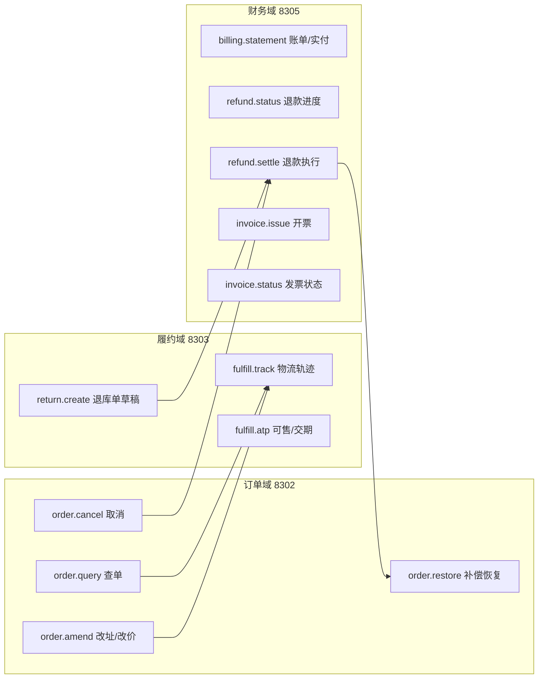
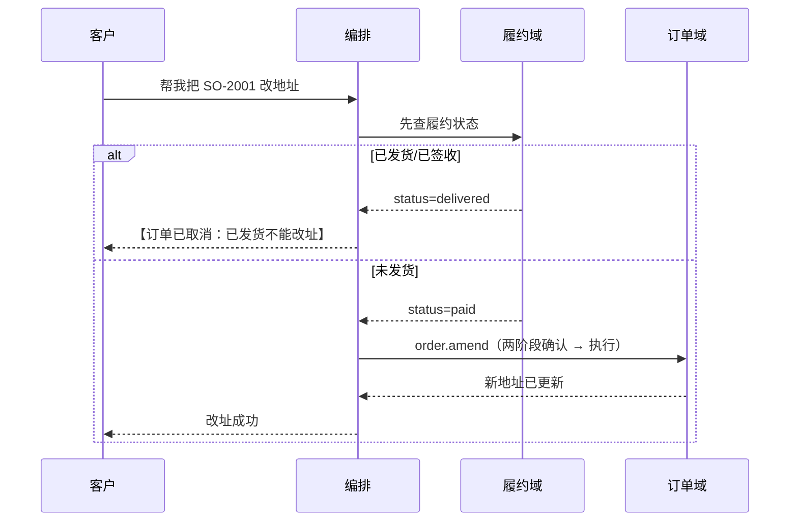
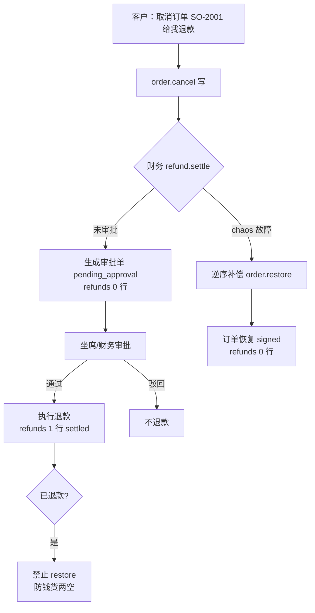
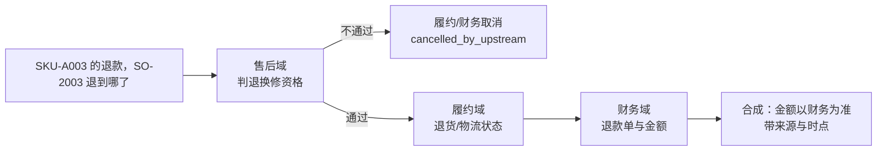
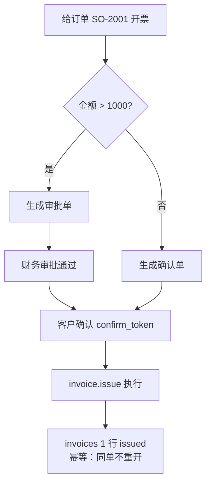
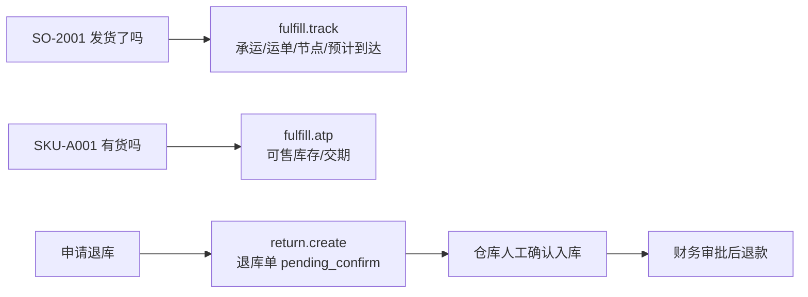
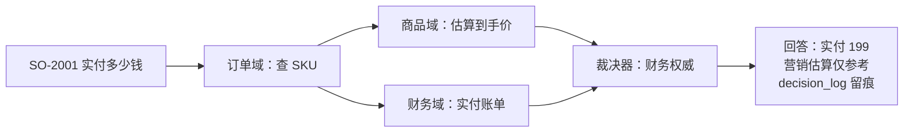

# 三域业务流程与数据字典（订单 · 履约 · 财务）

> 口径：按域分工口径——**订单、履约、财务**三域共 **12 个工具**（4+3+5）。
> 早期口径的「11 个工具」是 `return.create`（退库单草稿）上线前的数字；该工具在 commit
> 本文是当日快照（三域合计 12）；三域当前已增至 13（履约域 + subsidy 不在本域）。全项目当前口径以 `docs/STATS.md` 为准（35 个 `@tool`、33 类意图）。
>
> 售后（aftersale）是退款三域链的**上游协作方**（判资格），不在你主责范围；图 4 把它
> 标为「协作域」。如果你的口径是售后/履约/财务，只需把图 4 第一跳并入主责，其余不变。

## 1. 三域能力清单（12 个工具）

| 域 | 端口 | 工具 | skill | 读写 | scope | 关键入参 | 人工门禁 |
|---|---|---|---|---|---|---|---|
| 订单 | 8302 | `order_query` | order.query | 读 | order.read | order_no | — |
| 订单 | 8302 | `order_amend` | order.amend | 写 | order.write | order_no / address / new_price | 两阶段确认；改价>500 审批 |
| 订单 | 8302 | `cancel_order` | order.cancel | 写 | order.write | order_no / reason | Saga 正向步骤；biz_key 幂等 |
| 订单 | 8302 | `restore_order` | order.restore | 写 | order.write | biz_key | **仅 Saga 补偿通道**；已退款拒绝 |
| 履约 | 8303 | `fulfill_track` | fulfill.track | 读 | fulfillment.read | order_no | — |
| 履约 | 8303 | `fulfill_atp` | fulfill.atp | 读 | fulfillment.read | sku | — |
| 履约 | 8303 | `return_create` | return.create | 写 | fulfillment.write | order_no / reason | 只建退库单草稿（pending_confirm），入库由仓库人工确认 |
| 财务 | 8305 | `billing_statement` | billing.statement | 读 | finance.read | order_no | —（金额权威源） |
| 财务 | 8305 | `refund_status_query` | refund.status | 读 | finance.read | order_no | — |
| 财务 | 8305 | `invoice_status_query` | invoice.status | 读 | finance.read | order_no | — |
| 财务 | 8305 | `invoice_issue` | invoice.issue | 写 | finance.write | order_no / title | 两阶段确认 + 金额>1000 审批 + 幂等 |
| 财务 | 8305 | `refund_settle` | refund.settle | 写 | finance.write | order_no / approval_id | **退款无论金额一律人工审批**；双人复核>2500；幂等 |

**一句话记法**：订单管「单」，履约管「货」，财务管「钱」；改地址是履约先判、订单后动；退款是订单取消在前、财务动钱在后，中间永远隔着人工审批。

## 2. 主要流程

### 图 1：三域能力总览



### 图 2：改址（串行：履约判定 → 订单执行）



要点：**上游否决，下游不调用**；订单状态不变（`tests/test_m3_e2e.py::test_order_amend_veto_shipped` 验证）。

### 图 3：取消订单 + 退款（Saga 写链，你主责的核心）



- 幂等键：`{conversation}:{order_no}:cancel` / `:refund`；`refunds(tenant, order)` 的
  settled 唯一索引兜底跨会话重复退款；
- 补偿校验业务回执（`verified`），失败升级人工，不自动重试。

### 图 4：退款状态查询（三域串行，售后是上游协作域）



意图 `refund_status`，路由表 `["aftersale","fulfillment","finance"]` serial；你负责其中
**履约 + 财务两跳**，且这条链的金额权威、时点一致性由财务产物负责。

### 图 5：开票（财务单域写，三道门）



### 图 6：履约只读与退库单



### 图 7：实付金额仲裁（财务是权威）



## 3. 涉及的表与字段

### 3.1 订单域

| 表 | 关键字段 | 含义 | 读写 |
|---|---|---|---|
| `orders` | `tenant_id, order_no(PK)` | 租户 + 订单号 | 读/写状态 |
| | `customer_id` | 归属客户（对象级授权） | |
| | `status` | pending_payment / paid / shipped / in_transit / signed / cancelled | 写 |
| | `amount, paid_at, pay_channel` | 订单金额、支付时间、渠道；**实付权威在财务** | 读 |
| | `address, receiver, phone` | 收货信息（改址写这里） | 写 |
| `order_items` | `(tenant_id, order_no, sku)` | 行项目与单价/数量 | 读 |
| `order_cancel_log` | `(tenant_id, log_id)` | 取消留痕 | 写 |
| | `biz_key` | 幂等键（唯一索引） | |
| | `prev_status` | 取消前状态（补偿恢复依据） | 读/写 |

### 3.2 履约域

| 表 | 关键字段 | 含义 | 读写 |
|---|---|---|---|
| `shipments` | `(tenant_id, order_no)` | 运单主表 | 读 |
| | `carrier, tracking_no` | 承运商 / 运单号 | |
| | `status, shipped_at, estimated_delivery` | 发货状态、发货时间、预计到达 | |
| `shipment_nodes` | `(tenant_id, node_id)` | 物流节点 | 读 |
| | `node_time, location, description, status` | 节点时间/地点/描述/状态（唯一键含 order+time+desc） | |
| `products` | `(tenant_id, sku)` | 商品档案 | 读 |
| | `stock, status, lead_time_days` | 可售库存、上下架、交期（ATP 用） | |
| `return_orders` | `(tenant_id, return_id)` | 退库单 | 写草稿 |
| | `order_no, customer_id, reason, status` | 订单/客户/原因/状态（pending_confirm） | |
| | `biz_key` | 幂等键（唯一索引） | |

### 3.3 财务域

| 表 | 关键字段 | 含义 | 读写 |
|---|---|---|---|
| `orders` | `paid_at, amount` | 实付账单（金额权威；无 paid_at 不能退款） | 读 |
| `refunds` | `(tenant_id, refund_id)` | 退款单 | 写 |
| | `order_no, biz_key, amount, status` | 订单/幂等键/金额/状态（settled） | |
| | 唯一索引 `idx_refunds_biz_key` | 同会话重放不重复 | |
| | 唯一索引 `idx_refunds_order_settled` | **一单一笔已退款**（跨会话兜底） | |
| `invoices` | `(tenant_id, invoice_id)` | 发票 | 写 |
| | `order_no, biz_key, title, status` | 订单/幂等键/抬头/状态（issued） | |
| | 唯一索引 `idx_invoices_order_issued` | 一单一票 | |
| `order_cancel_log` | `biz_key, prev_status` | 补偿恢复依据 | 读（补偿） |

### 3.4 安全库（security.db，单写者 securityd）

| 表 | 关键字段 | 含义 |
|---|---|---|
| `approvals` | `id, action, target, amount, status` | action∈refund/invoice/price_change；status pending→approved→executed/rejected/expired |
| | `required_approvals, approver_roles, dual_control` | 1 人/双人复核与角色约束 |
| | `requested_by` | 申请人（不能自批） |
| | `resume` | 审批通过后的恢复载荷 |
| `confirmations` | `confirm_token, action, target, payload_hash` | 两阶段确认；payload_hash 防篡改；一次性 + TTL |
| `audit_events` | `event_id, seq, prev_hash, entry_hash, signature` | HMAC 哈希链，篡改/删尾可定位 |
| `audit_heads` | `tenant_id, seq, entry_hash` | 每租户链尾指针 |

### 3.5 状态机

```
orders:    pending_payment → paid → shipped → in_transit → signed
                                    ↘ cancelled（取消）
refunds:   （无记录）→ settled（唯一；未审批不落行）
invoices:  （无记录）→ issued（唯一）
return_orders: pending_confirm →（仓库人工确认，当前版本未实现后续状态）
approvals: pending → approved → executed / rejected / expired
```

## 4. 失败与边界（如实标注）

| 场景 | 当前行为 | 结论 |
|---|---|---|
| 财务退款失败（chaos） | 逆序 `order.restore`，订单恢复原状态、0 退款 | ✅ 已实现 |
| 已退款订单被 restore | 返回 `refund_settled`，拒绝恢复 | ✅ 防钱货两空 |
| 同/跨会话重复退款 | biz_key / settled 唯一索引兜底，仍 1 笔 | ✅ 已实现 |
| 已发货订单直接 `cancel_order` | **当前没有状态守卫**，在途/已签收也能取消 | ⚠️ 已知缺口（方案一补） |
| 改地址已发货 | 履约域否决，订单不调用 | ✅ 已实现 |
| 发票红冲/作废 | 未实现 | ⚠️ 缺口 |
| 部分退款（按行项目） | 未实现，只支持整单按实付退 | ⚠️ 缺口 |
| 账期客户退款冲应收 | 未区分，统一按退款单记录 | ⚠️ 缺口 |
| 退库单后续（入库/验收） | 只到 pending_confirm，仓库人工线下处理 | ⚠️ 边界 |

## 5. 60 秒概览

> “订单、履约、财务三个域，共 12 个工具。订单域管单：查单、改址改价、取消、Saga
> 补偿恢复；履约域管货：物流轨迹、可售交期、退库单草稿；财务域管钱：账单实付、退款
> 进度、退款执行、开票和发票状态。核心链路有三条：改址是履约先判、订单后动，已发货直
> 接否决；取消退款是订单取消在前、财务退款在后，中间隔人工审批，失败逆序恢复订单，已
> 退款禁止恢复防钱货两空；退款状态是售后判资格、履约验货、财务给金额，三域串行，上游
> 否决下游不调。金额永远以财务账单为权威，重复退款靠 biz_key 加一单一笔唯一索引兜底。”
