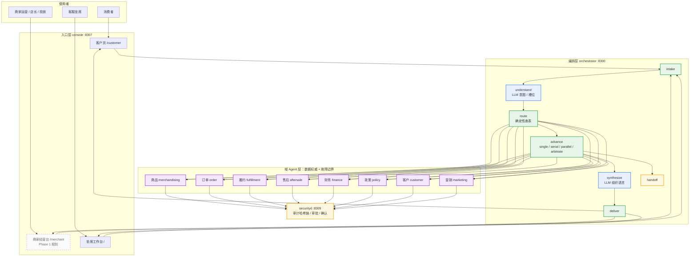
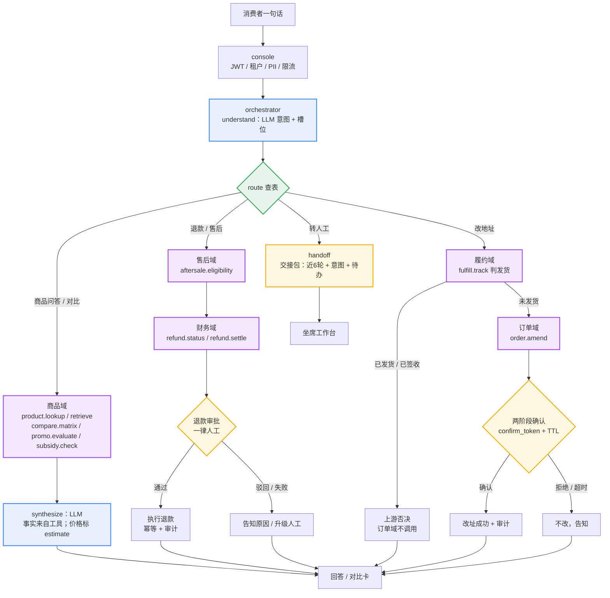
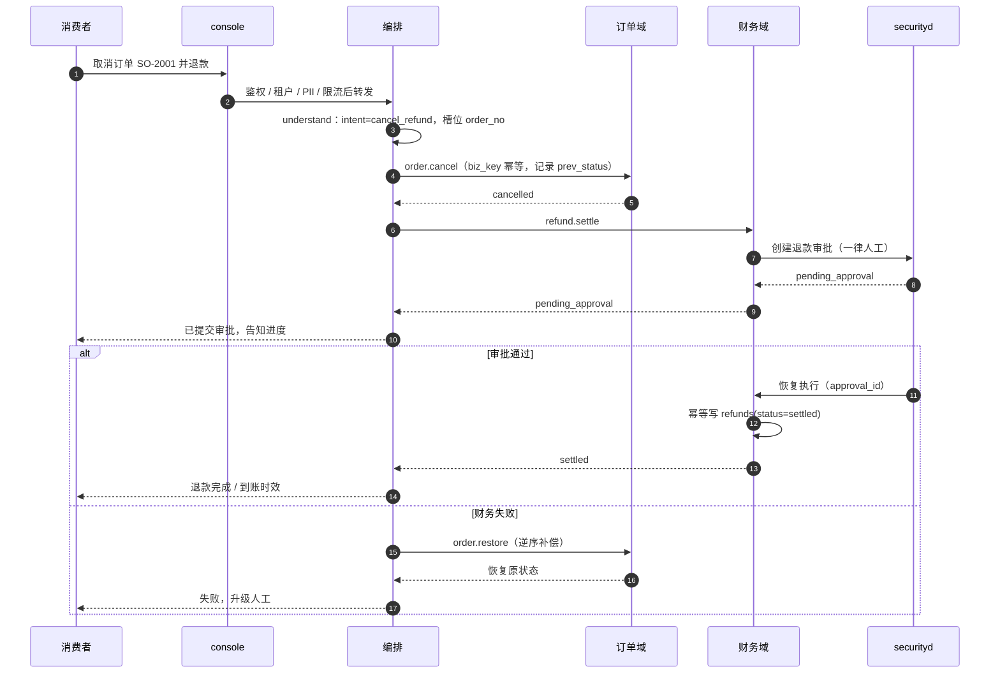
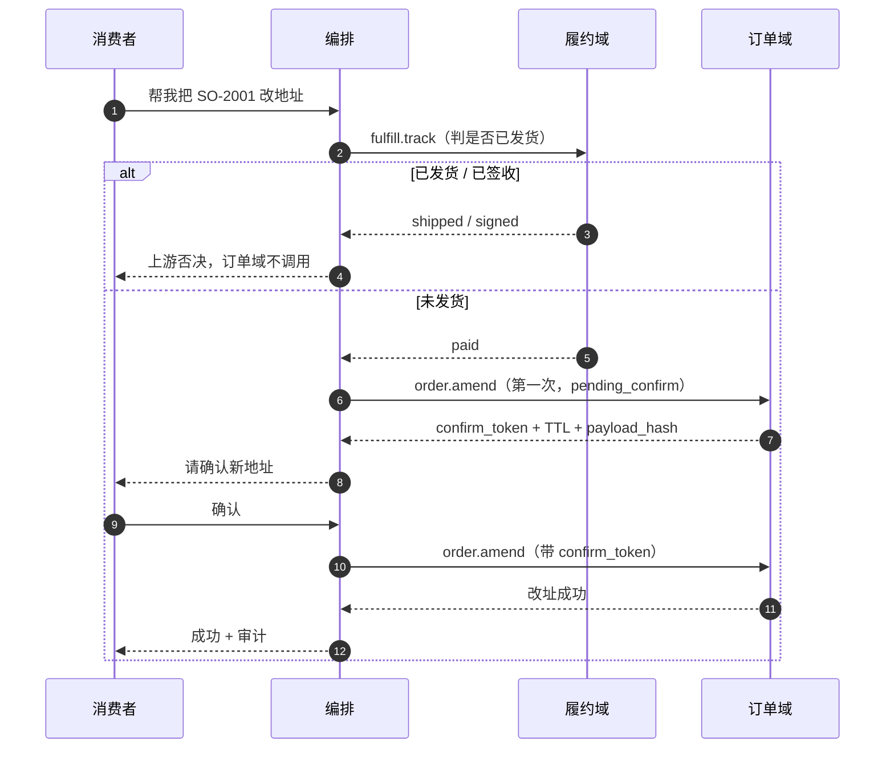
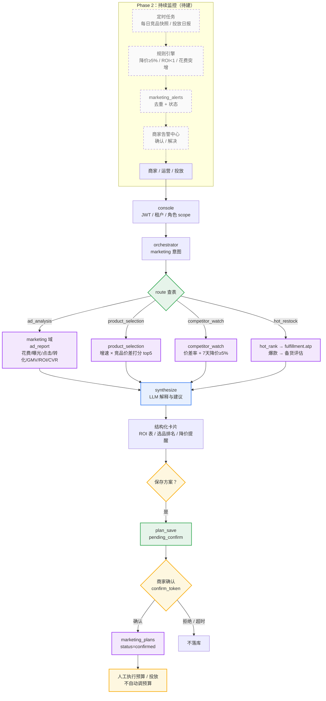

# 双端经营助手 · 流程图

> 口径：**消费者侧 = LLM 导购/问答 + 规则化交易办理；商家侧 = 数据经营助手（投流/选品/竞品）。**
> 图例：蓝 = LLM；绿 = 规则/路由；橙 = 人工门禁；紫 = 域数据/工具；虚线 = 规划中。
> 现状：消费者侧已交付；商家侧营销域 5 工具已通，商家入口/持续监控为 Phase 1–2。

---

## 1. 双端总览：两个入口，一套底座

**一句话**：消费者和商家不是两套系统，只是两个入口、两组意图、两套工具白名单；域数据只有一份，审计/审批只有一套。

---

## 2. 消费者侧：LLM 负责听懂和解释，规则负责事实和边界

**关键边界**：

- 商品价格、库存、退款资格、订单状态：**只认域工具/RAG**，LLM 不得自己算、自己编。
- 退款：LLM 只识别“要退款”和订单号；`refund.settle` 无论金额一律人工审批。
- 改地址：先由履约域判是否已发货；已发货直接否决，未发货才进订单域两阶段确认。
- LLM 不直接写库；写操作只有“确认 + 审批 + 幂等 + 审计”这一条路。

### 2.1 取消订单 + 退款（Saga + 审批）

### 2.2 改地址（履约先判 + 两阶段确认）

---

## 3. 商家侧：数据经营助手，建议 + 人工确认，不自动执行

**关键边界**：

- 三个助手都是**数据分析 + 建议**：ROI 分档、选品打分、降价提醒由规则/工具计算，LLM 只解释。
- `plan_save` 只落“计划单”，不执行预算/投放；预算变更仍需人工审批。
- 竞品监控现在是“问才查”；Phase 2 才加定时快照、告警去重、告警中心。
- 库存权威在履约域：选品/爆款要备货结论，走 `hot_restock` 的 marketing → fulfillment 仲裁链，营销域不自己下库存结论。

---

## 4. 一张图记住

| 侧 | LLM 做什么 | 规则/工具做什么 | 人工门禁 |
|---|---|---|---|
| 消费者 | 意图、槽位、多轮、对比叙述、政策解释 | 商品/订单/履约/售后/财务工具；路由查表 | 退款审批、改址确认、转人工 |
| 商家 | 解释 ROI/选品/竞品结论，生成建议 | 营销域 5 工具；ROI/价差/降价规则 | 计划单确认、预算执行、选品会/定价 |

> 对外一句话：**“消费者侧做 LLM 导购/对比 + 规则化交易办理；商家侧做投流、选品、竞品三个数据经营助手；两侧共用一套域工具、编排、权限、审批和审计。”**
